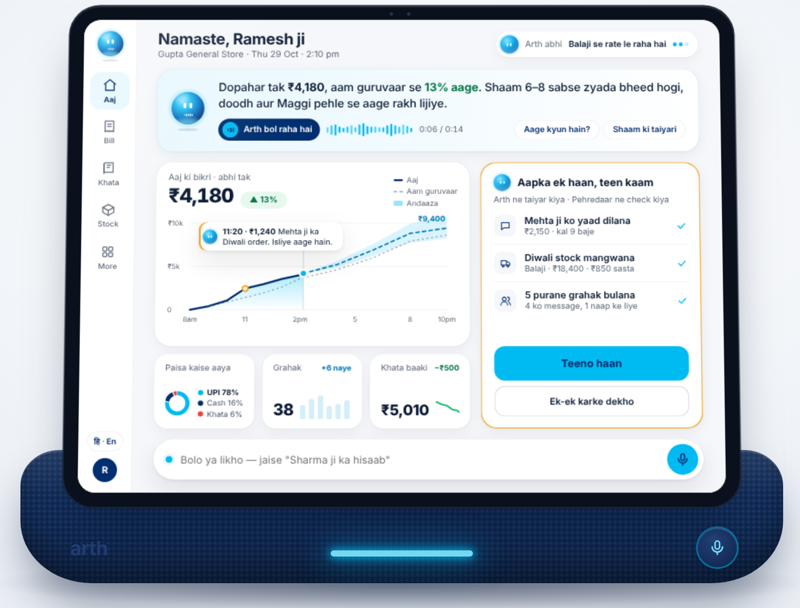
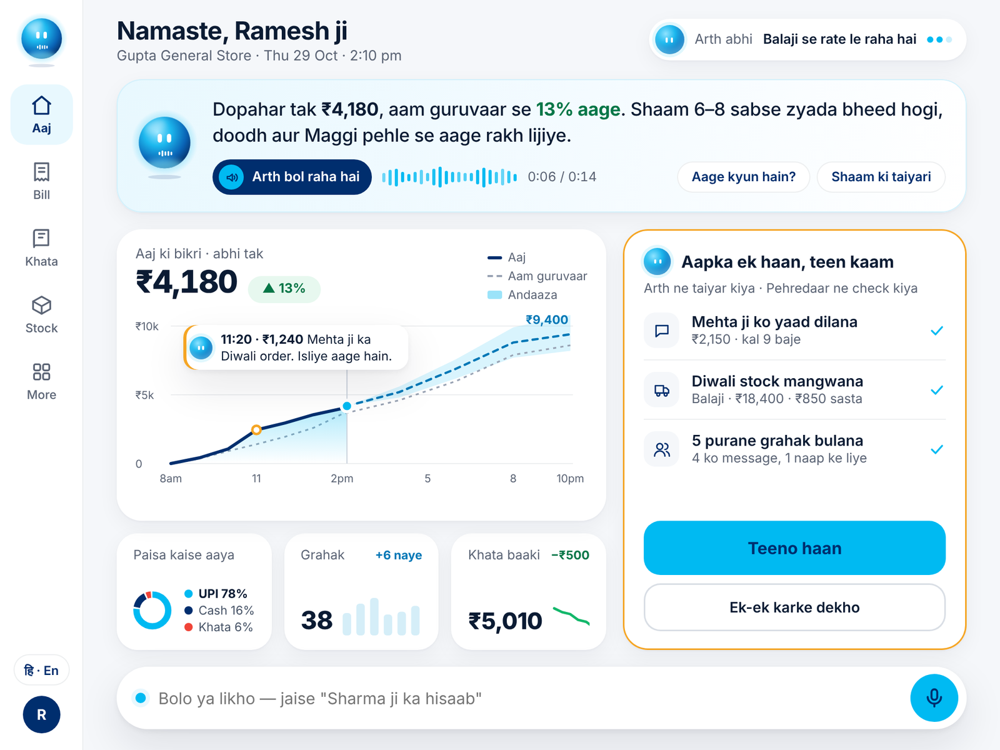
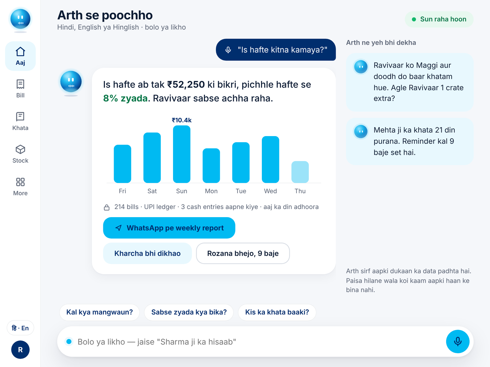
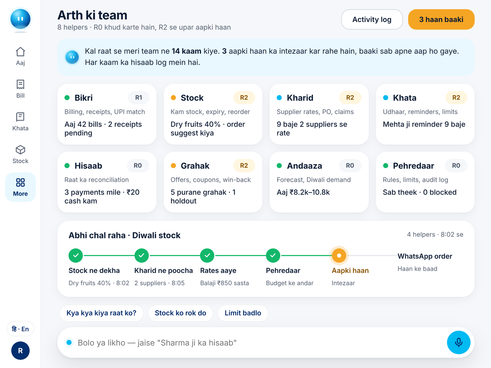
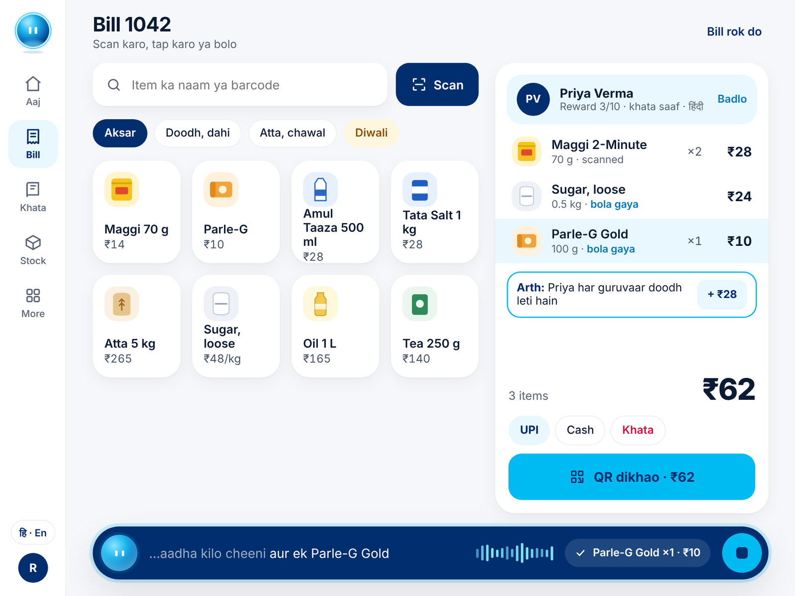
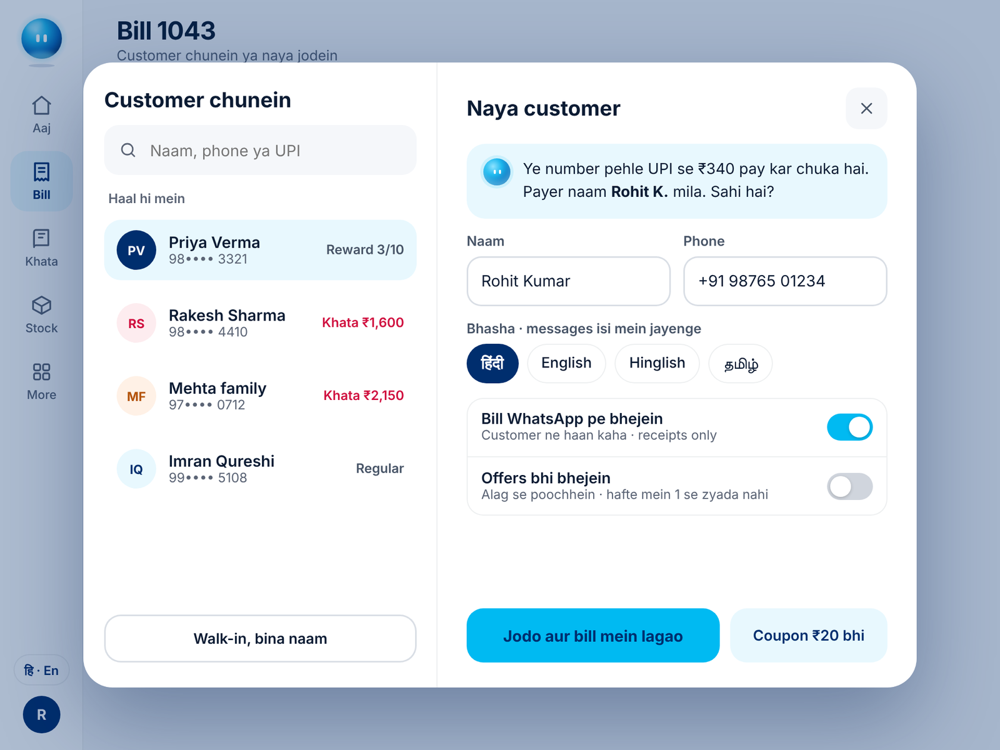
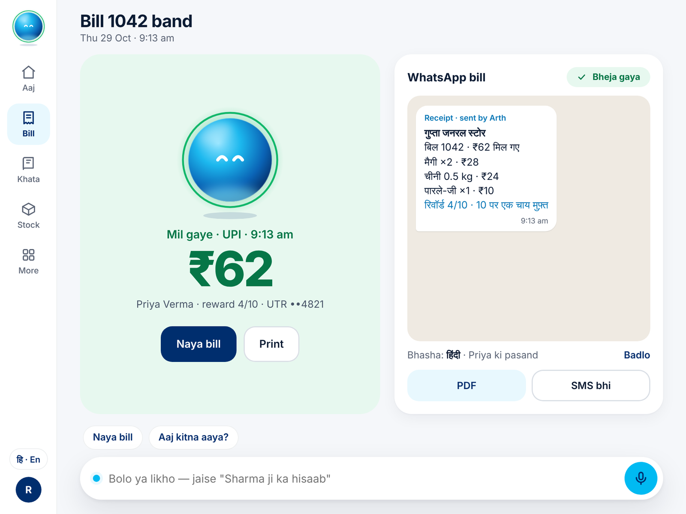
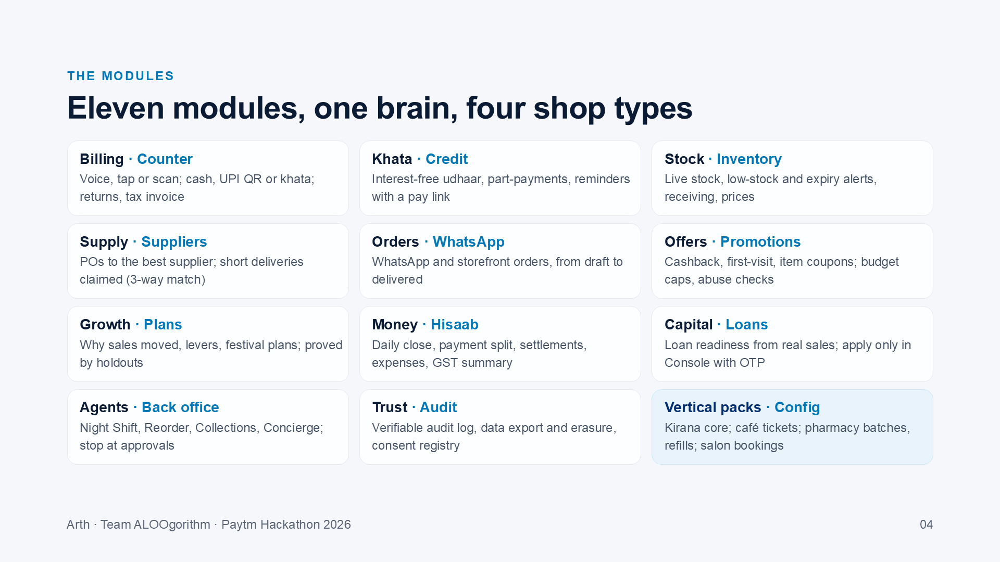
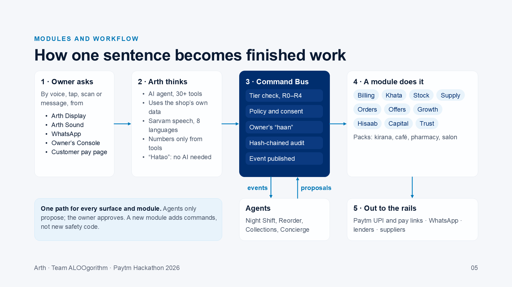
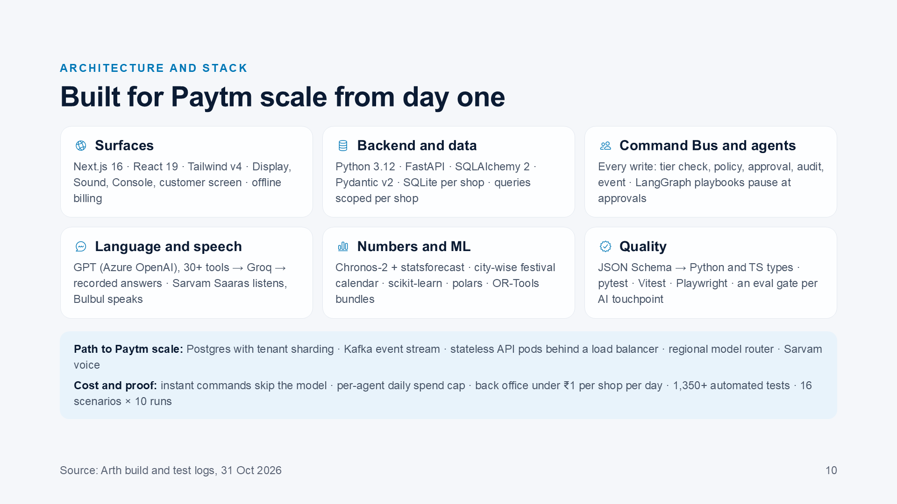

<div align="center">

# Arth · अर्थ

**Har payment ka arth, har dukan ki taraqqi**

The AI business partner on the Paytm Soundbox. It runs the shop, follows through and grows the business, in the owner's language.

Paytm Hackathon 2026 · Merchant Growth AI · Team ALOOgorithm



</div>

---

## Why Arth

Crores of shops already take payments on Paytm. The Soundbox tells the owner how much came in, never what to do next. The shop still runs on memory and a paper khata, and business apps that ask a busy owner to type in English go unused.

| Problem at the counter | What Arth does |
| --- | --- |
| Doesn't know what sold today | Voice billing; ask anything, get answers grounded in the shop's own data |
| Udhaar leaks from a paper khata | Khata by voice; dues reminders with a UPI pay link |
| Festival stock-outs | Festival forecast, reorder drafts, short-delivery claims |
| Regulars drift away unnoticed | Counter hints and offers, measured against holdout groups |
| No record for a loan | Loan readiness from real sales; apply only in the Console with OTP |
| Fake payment screenshots | Screenshot checked against real payments |
| English apps go unused | Talk in 8 Indian languages; Arth acts only after the owner's "haan" |

Say it, and it gets done:

> "Priya ka bill banao, 2 Parle-G aur ek Maggi… khate mein daal do."
> "Diwali ke liye kya kar sakte hain?"
> "Meena ko dues ka message bhejo."

## Screens

<table>
  <tr>
    <td width="33%"></td>
    <td width="33%"></td>
    <td width="33%"></td>
  </tr>
  <tr>
    <td><b>Today at a glance.</b> Spoken brief, sales against a typical day, one "haan" for three jobs.</td>
    <td><b>Ask anything.</b> Grounded answer with a chart and its source; forecasts come as ranges with reasons.</td>
    <td><b>A team of agents.</b> Night Shift, Reorder, Collections and Concierge stop at a gate near money.</td>
  </tr>
  <tr>
    <td></td>
    <td></td>
    <td></td>
  </tr>
  <tr>
    <td><b>Scan, tap or say it.</b> "Aadha kilo cheeni" becomes a bill line as the owner talks.</td>
    <td><b>Pick or add a customer.</b> Consent for receipts and for offers is asked separately.</td>
    <td><b>Paid on the rails.</b> Receipt on WhatsApp in the customer's language.</td>
  </tr>
</table>

Every screen also runs in Hindi, Hinglish, Marathi, Tamil, Bengali, Gujarati and Telugu.

## Where it runs

| Surface | Who uses it | What it does |
| --- | --- | --- |
| Arth Display (4:3 screen + voice) | Owner and staff | Billing, khata, stock and approvals by voice or tap |
| Arth Sound (voice only) | Screenless shops | The same AI through the speaker and one button |
| WhatsApp | Customers, suppliers | Bills, pay links, reminders, orders, supplier POs |
| Owner's Console | Owner | Approvals, loans with OTP, reports |
| Customer display and UPI pay page | Customer | Sees the bill, pays by QR |

## Modules



A new shop type is a config pack (units, categories, offer types, playbooks), not a rewrite. Four packs ship today: **kirana** (the core), **café** (kitchen tickets), **pharmacy** (batches, expiry, refills) and **salon** (appointments).

## How it works



Every write, from any surface, human or agent, goes through one **Command Bus**:

1. **Tier check (R0–R4):** reads run freely (R0); small changes get a 30-second undo (R1); money moves after a read-back and the owner's "haan" (R2); customer messages and orders need the owner's approval (R3); loans and refunds need the Console and an OTP (R4).
2. **Policy and consent:** no WhatsApp to a customer without their own yes; quiet hours and contact caps for Arth's own follow-ups.
3. **Hash-chained audit:** every decision is logged, and the chain can be verified in one tap.
4. **Event published:** screens update live, and agents pick up the work.

Agents only propose; the owner approves. A new module adds commands, not new safety code.

### The AI

- **One agent, 30+ tools** over the shop's own data. It reads (sales, stock, khata, forecast, festivals) and acts (bills, payments, reminders, prices, reorders, growth plans) through the same bus.
- **Grounded:** every number Arth says comes from a tool call; unsupported claims are blocked and repaired.
- **In the owner's language:** Sarvam Saaras listens and Bulbul speaks, in 8 languages, with short replies.
- **Fast at the counter:** commands like "hatao" or "QR dikhao" run instantly without the model. AI answers took 2–6 s in our runs.
- **Safe near money:** Arth never approves anything itself. Customer names are masked before the model sees them, and a Critic blocks interest, fees or shaming language in khata messages.
- **Provider fallback:** GPT on Azure OpenAI, then Groq, then recorded answers, so billing never stops.

## Architecture and stack



**Path to Paytm scale:** Postgres with tenant sharding, a Kafka event stream, stateless API pods behind a load balancer and a regional model router. Payments, WhatsApp and lenders are simulated behind the same interfaces the real adapters will use.

## Repository layout

```
backend/     FastAPI app (arth/): Command Bus, governance, domains, AI, agents, simulators, tools
frontend/    Next.js app: device, voice device, console, customer display, pay page, phones, stage, director
contracts/   JSON Schema and OpenAPI: the source of truth for Python and TypeScript types
design/      Design tokens and design references
docs/        Specs, pitch deck, handoffs and README images
dev.py       One entry point for setup, codegen, checks, servers and the demo
```

Generated code (`backend/arth/contracts/`, `frontend/lib/contracts/`, `frontend/app/tokens.css`) is never edited by hand. Change `contracts/`, then run `python dev.py gen`.

## Getting started

**Prerequisites:** Python 3.12, [uv](https://docs.astral.sh/uv/), Node.js 22 and pnpm 10.

```bash
python dev.py setup          # install backend and frontend dependencies, generate contracts and tokens
cp backend/.env.example backend/.env   # then add your keys
```

Provider keys live only in `backend/.env`; the web app never sees them:

| Key | Used for |
| --- | --- |
| `AZURE_OPENAI_ENDPOINT`, `AZURE_OPENAI_API_KEY`, `AZURE_OPENAI_API_VERSION` | Main LLM: the agent, tools, narration and guards |
| `GROQ_API_KEY` | LLM and speech-to-text backup |
| `SARVAM_API_KEY` | Speech to text (Saaras), text to speech (Bulbul), translation |
| `MISTRAL_API_KEY` | OCR |

In `dev` and `demo` mode, a missing key falls back to recorded answers, so the app still runs.

Run the two servers in separate terminals:

```bash
python dev.py api            # FastAPI on http://localhost:8000
python dev.py web            # Next.js on http://localhost:3000
```

## Run the demo

With both servers running:

```bash
python dev.py demo           # restore the saved Gupta General Store in about 3 seconds
python dev.py demo -- --fresh   # rebuild it from scratch (40 days of history, about 2–3 minutes)
```

The demo shop is Gupta General Store, ten days before Diwali: Night Shift has already run, three reorders wait on the checklist and two Diwali offers are live.

| Page | URL |
| --- | --- |
| Stage: device, phones and live Trace, AI calls and Logs side by side | http://localhost:3000/stage |
| Director: play the demo beat by beat, control the clock | http://localhost:3000/director |
| Device alone | http://localhost:3000/device/home |

The scripted day:

| Time | What happens |
| --- | --- |
| 7:45 | Morning brief; "Haan, teeno" approves three reorders |
| 9:12 | Priya's bill by voice, a counter hint, paid by UPI QR |
| 10:30 | Sugar reorder drafted for Diwali; the PO goes to the supplier |
| 11:15 | A forwarded ₹450 payment screenshot checked against real payments |
| 12:40 | "Is Diwali bikri kaise badhayein?" → diagnosis, plan and live offers |
| 6:41 | "Priya ne 50 jama kiye" → read-back → "haan" |
| 8:30 | Ask Arth in Tamil, then verify the audit trail in one tap |

## Checks

```bash
python dev.py check          # contract drift, lint, typecheck and tests for backend and frontend
python dev.py e2e            # starts its own API (:8010) and web (:3010), then runs the Playwright suite
```

The first time on a new machine, install the browser: `pnpm --filter frontend exec playwright install chromium`.

## Team

**Team ALOOgorithm** · Paytm Hackathon 2026
