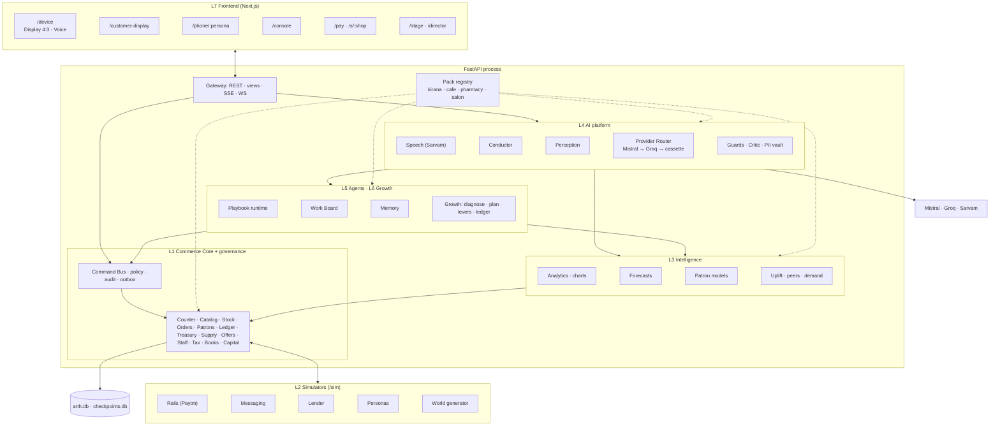

# Arth v6: Merged Product, Frontend and Backend Specification

**Paytm Hackathon 2026 · Track: Merchant Growth AI**
Team ALOOgorithm · Spec v6.0 · 30 Oct 2026 · Status: draft for review

> **What this document is.** The single build specification for Arth: every feature, every backend component, every screen, the contracts between them, and the order in which they are built. Frontend and backend are specified together, so each feature can be traced from the screen the owner touches to the table that stores it.
>
> **Relationship to v5.1.** `docs/reference/Arth_Spec_v5.1.md` and `docs/reference/Arth_Demo_Workflow_v5.1.md` stay in the repo as reference. Every v5.1 requirement ID is kept and traced here (Part M). Where v5.1 already gives a detailed acceptance criterion, v6 cites it as **"v5.1 §x"** instead of copying it. **Where v6 and v5.1 differ, v6 wins.**
>
> **Companion document.** `2026-10-30-arth-v6-demo-and-scenarios.md` covers the scenario library, the scenario language and the stage demo.

---

## Contents
- **Part 0** [What changed in v6](#part-0-what-changed-in-v6)
- **Part A** [Product](#part-a-product)
- **Part B** [System architecture](#part-b-system-architecture)
- **Part C** [Contracts](#part-c-contracts)
- **Part D** [Vertical packs](#part-d-vertical-packs)
- **Part E** [Feature catalogue](#part-e-feature-catalogue)
- **Part F** [Backend components by layer](#part-f-backend-components-by-layer)
- **Part G** [AI platform and providers](#part-g-ai-platform-and-providers)
- **Part H** [Simulation](#part-h-simulation)
- **Part I** [Frontend](#part-i-frontend)
- **Part J** [Screen specifications](#part-j-screen-specifications)
- **Part K** [Build stages](#part-k-build-stages)
- **Part L** [Quality and verification](#part-l-quality-and-verification)
- **Part M** [Traceability matrix](#part-m-traceability-matrix)
- **Part N** [Risks and open questions](#part-n-risks-and-open-questions)

---

## Part 0: What changed in v6

| # | Change | Why |
|---|---|---|
| 1 | **Frontend and backend are one spec.** Every screen has a route, a view endpoint, its states, its actions (with risk tier) and its voice equivalent | v5.1 deferred the UI; the designs in `design/` now exist and need binding |
| 2 | **Nothing is hardcoded to the demo.** Names, numbers, suppliers and story beats live in scenario data. Screens render whatever the data says | The system must work for any merchant and any scenario. The Gupta Diwali story becomes one scenario among many |
| 3 | **Vertical packs.** A generic merchant core plus plug-in packs: kirana (reference), café, pharmacy, salon | "Every Paytm merchant" |
| 4 | **AI providers and frameworks.** Mistral is the LLM, Groq is the LLM backup, Sarvam does speech (Saaras v4, Bulbul v4 Flash) and translation. LangGraph orchestrates; direct SDKs sit behind Arth's Provider Router (Part G0) | Team decision, 30 Oct 2026 |
| 5 | **New features:** onboarding, staff and shifts, batches and expiry, GST invoices, month-end books, storefront link, feedback, payment exceptions, calendar engine, trust centre, device health, voice parity, full multilingual UI | Gaps a real merchant hits on day one (Part E2) |
| 6 | **New navigation tab: Badhao (Grow).** Rail: Aaj · Bill · Khata · Stock · Badhao · More | Growth is the track's headline and needs a first-class home |
| 7 | **The stage.** The 4:3 device, phones, customer display and an evidence panel (trace, tools, AI calls, tables, logs, health) on one 1920×1080 composition | Shows the system working, not just the UI |
| 8 | **Layered build plan** (L0–L8). Each layer ends with an automated checkpoint driven through the real API | Capacity is unknown; each layer stays independently verifiable |
| 9 | **Eight UI languages:** Hindi, English, Hinglish, Marathi, Tamil, Bengali, Gujarati, Telugu. Screen, voice and customer-message languages are set separately | The Language screen already promises this |
| 10 | **India-wide festival calendar** by state and city, with sources and confidence (Part D3) | Festivals and dates differ across cities and states |

**Conflicts between the existing screens and v5.1 are resolved by data binding, not by redesign.** Where a screen showed literal copy that disagreed with the spec (Balaji vs Agarwal, the ₹660 oil claim vs the ₹50 sugar claim, "Diwali 4 din door", tier badges), that copy becomes a binding to live data. Layouts stay as designed. Part J lists every binding change.

---

## Part A: Product

### A1. What Arth is
**Arth is an AI business partner for Paytm merchants, living on the Paytm Soundbox.** It does three jobs:
1. **Runs the shop:** billing by scan, tap or voice; one set of books (sales, khata, stock, orders, suppliers, staff, tax); payment assurance; and an owner who can ask anything and get a grounded answer with a chart.
2. **Does the follow-through:** a back office of agents runs multi-day work (procurement, collections, customer chat, night close), waiting on the world and stopping at approval gates.
3. **Grows the shop:** it finds where weekly gross profit is leaking, plans at most three measurable moves, runs them, and proves the result against holdout groups.

It comes in two editions on the same brain:
- **Arth Display:** an 8-inch 4:3 touchscreen on a knit speaker base, with a rear dot display facing the customer.
- **Arth Voice:** screenless, with one button and a light bar.

The owner approves the moments that matter with one word. Everything else arrives as a short morning brief.

### A2. Users
| User | What they need | Where they meet Arth |
|---|---|---|
| **Owner** | Speed at the counter, no surprises with money, more customers and margin, no paperwork | Device, Console (phone app), WhatsApp thread with Arth |
| **Staff** (helper, cashier) | Bill fast, see pick lists, no access to money decisions | Device (PIN session), helper phone |
| **Customer** | Pay easily, get a receipt, order on WhatsApp, offers that are actually useful, credit with dignity | Customer display, WhatsApp, UPI app, storefront page |
| **Supplier** | Clear RFQs, POs and claims | WhatsApp |
| **Paytm** (platform) | Merchant retention, UPI volume, a better lending book, peer data network | Rails, lender sandbox, peer cohorts (all simulated here) |

### A3. Product principles
1. **Numbers come from code, never from the LLM.** Language models do language: understanding, reading documents, drafting, checking, explaining.
2. **Weekly gross profit is the north star.** Sales can be bought with discounts; gross profit can't.
3. **Every growth move has a holdout.** Results are labelled *measured*, *direct* or *estimated*.
4. **Nothing leaves the shop without the owner's approval**, at the right risk tier. Regulated actions (loans, refunds, write-offs) happen only in the Console with OTP, never by voice, and never by an agent.
5. **Workflows with bounded AI steps**, not open-ended agents.
6. **Data-driven everywhere.** No merchant, person, number or festival is hardcoded. Vertical behaviour comes from packs.
7. **Voice parity.** Anything the owner can do by touch, they can do by voice, in their language.
8. **Dignity.** Arth never says "fake", never shames a debtor, never mentions one customer to another.

### A4. Feature map (summary; full catalogue in Part E)
| Job | Feature groups |
|---|---|
| Run the shop | Onboarding, Counter, Catalog, Stock with batches and expiry, Orders, Patrons and consent, Ledger (khata, payables), Treasury, Payment exceptions, Sentinel, Supply, Capital, Staff and shifts, Tax, Books |
| Know the shop | Ask Arth (voice, Console, WhatsApp), insights, 12 core charts plus pack charts, reports, forecasts as ranges, alerts, morning brief, calendar engine |
| Do the follow-through | Night Shift, Procurement, Collections, Concierge, Analyst, Curator, Strategist, Outreach; Work Board; Merchant Memory; Critic; Arena |
| Grow the shop | Diagnostics, patron intelligence, peer benchmarks, counter hints, win-back, replenish, repeat order, demand capture, bundles and pre-orders, credit advisor, welcome and opt-in, offers, storefront, feedback and recovery, growth plans, Growth Ledger, pack levers |
| Keep it safe | Risk tiers, scope-bound approvals, owner-bound voice, Grounding Guard v2, Injection Shield, PII vault, Critic, audit chain, budgets, kill switch, holdouts, fairness, trust centre, DPDP rights |

### A5. What is real and what is simulated
| Real (working code, live calls) | Simulated (labelled on screen) |
|---|---|
| Mistral LLM, vision and OCR; Groq fallback; Sarvam STT, TTS, translation | Paytm payments, QR, links, settlement, refunds, cashback |
| Conductor, playbook runtime, approvals, audit chain | Partner lender and loan journey |
| Ledger, billing, credit, stock, orders, supply, offers logic | Customer UPI app |
| Barcode scanning (HID or camera) | WhatsApp transport (real bridge optional) |
| Forecasting, patron models, uplift statistics, bandits | Generated shop history; peer cohorts; customer and supplier replies (scripted or LLM personas) |
| SQLite; both device editions; all four packs | The clock (director-controlled) |

---

## Part B: System architecture

### B1. The nine layers
| # | Layer | Responsibility | Depends on |
|---|---|---|---|
| L0 | Foundations and contracts | Repo, tooling, contracts and codegen, DB plumbing, Sim Clock, config and policies, pack registry, design tokens, i18n skeleton, spans | — |
| L1 | Commerce Core and governance | The books (all domain modules) and the Command Bus with tiers, policy, audit, outbox | L0 |
| L2 | Simulators | Paytm Rails, messaging, lender, screenshot forge, persona engine, world generator, headless scenario runner core | L0, L1 (via HTTP and webhooks only) |
| L3 | Intelligence | Analytics tools, charts, forecasts, patron models, affinity, demand clusters, peers, uplift, next-best-action, alerts | L1 |
| L4 | AI platform | Provider Router, speech, normaliser, Conductor, perception, guards, Critic, PII vault, prompts and evals | L1, L3 |
| L5 | Agentic layer | Playbook runtime, waits, gates, Work Board, contact locks, memory, budgets, kill switch, the eight agents, Arena | L1, L3, L4 |
| L6 | Growth layer | Diagnostics, Strategist plans, levers (per pack), outreach campaigns, Growth Ledger | L1, L3, L4, L5 |
| L7 | Frontend | Design system, device (Display, Voice), customer display, phones, Console, customer pages, stage and Director | L0 contracts; the view endpoints of L1–L6 |
| L8 | Scenario library and demo | Scenario language, live Director, snapshots, scenario library, `demo-check` | All |

### B2. Component map


### B3. Runtime topology
- **One FastAPI process** hosts the API, the simulators (under `/sim`, with their own `sim_` tables, talking to Arth only over HTTP and signed webhooks), the scheduler and the playbook runtime. **One Next.js app** hosts every surface. This keeps demo day simple; the simulators can be split out later without code changes (v5.1 D1).
- **Storage:** SQLite in WAL mode (`data/arth.db`, `data/checkpoints.db`), one writer queue, a reader pool. Money as integer paise, IDs as ULIDs, time from the Sim Clock (UTC stored, IST shown). Details as v5.1 D2.
- **Production path** (not built, designed for): Postgres via SQLAlchemy dialect swap; the outbox moves to a queue; simulators are replaced by real adapters behind the same interfaces (Rails → Paytm APIs; Messaging → WhatsApp Cloud API).

### B4. Repository layout
```
Paytm/
  backend/                  Python 3.12 · FastAPI · uv (everything server-side)
    arth/
      core/                 paths, clock, ids, money, qty, db, tables, migrate, scheduler, config, packs, i18n, spans
      contracts/            generated Pydantic models (do not edit)
      api/                  HTTP routers (health, stream, director, …)
      governance/           command bus, tiers, policy, approvals, audit, outbox          (L1)
      domain/               counter, catalog, stock, orders, patrons, ledger, treasury,
                            sentinel, supply, capital, offers, staff, tax, books, storefront, feedback (L1)
      intel/                analytics, charts, forecast, patrons_ml, affinity, demand, peers, uplift, decision, alerts (L3)
      ai/                   router, speech, normalise, conductor, perception, guards, critic, pii, prompts, evals (L4)
      agents/               runtime, waits, work_board, memory, budgets, playbooks/*, arena (L5)
      growth/               diagnose, strategist, levers/*, outreach, ledger (L6)
      views/                screen view-model endpoints (L1+)
      sim/                  rails, messaging, lender, forge, personas, world, scenario_runner (L2)
      tools/                code generation and maintenance scripts
    tests/                  unit, property, contract, scenario, eval
    migrations/             Alembic
    config/                 policies.yaml, providers.yaml, helpers.yaml, calendar/*.yaml
    packs/                  kirana/, cafe/, pharmacy/, salon/ (manifest, catalog, templates, generator, scenarios)
    scenarios/              scenario library (YAML) + snapshots/                          (L2/L8)
    data/                   arth.db, checkpoints.db (runtime; not shared)
    .env, .env.example      API keys: read only by the backend
  frontend/                 Next.js 16 · React 19 · Tailwind v4 (every surface)
    app/                    routes: device, customer-display, phone, console, pay, s, stage, director
    components/             design system + card registry                                  (L7)
    i18n/                   message catalogues per locale                                  (L7)
    lib/                    format.ts, validate.ts; contracts/ = generated TS types (do not edit)
    scripts/                gen-contracts.mjs, build-tokens.mjs
    tests/                  Vitest
    .env.local              public settings only (NEXT_PUBLIC_*)
  contracts/                shared by both sides: envelope/event/problem schemas, openapi.yaml,
                            tokens.json, fixtures/, examples/
  design/
    boards/                 the .dc.html screens and component boards + canvas.json
    generator/              design generator sources (c2.py tokens, screens)
    previews/               rendered PNGs
  docs/
    specs/                  this spec and its companions
    superpowers/plans/      implementation plans
    reference/              v5.1 spec and demo workflow
  dev.py                    task runner: python dev.py setup|gen|lint|typecheck|test|check|build-web|api|web
  package.json, pnpm-workspace.yaml, .gitignore
```

### B5. Technology
| Area | Choice |
|---|---|
| Backend | Python 3.12, uv, FastAPI, SQLAlchemy 2 + aiosqlite, Alembic, Pydantic v2 |
| Agents | LangGraph + `langgraph-checkpoint-sqlite` |
| Numerics | numpy, polars, scipy, scikit-learn, mlxtend, statsforecast, `chronos-forecasting`, OR-Tools (bundles) |
| Matching | sentence-transformers (`multilingual-e5-small`), rapidfuzz, SQLite FTS5 trigram |
| AI and agents | LangGraph ≥ 1.2.12 + `langgraph-checkpoint-sqlite`; direct SDKs `mistralai`, `groq`, `sarvamai` behind the Provider Router; Pydantic v2 structured output; local `multilingual-e5-small` embeddings (decision record: Part G0) |
| Media | Pillow, imagehash, segno (QR), matplotlib (chart images) |
| Frontend | Next.js 16, React 19, Tailwind CSS v4 (tokens as CSS variables), TanStack Query, Zustand, Ajv, Dexie (offline journal), `@zxing/browser`, a small SVG chart kit built to the design language |
| Testing | pytest, hypothesis, Vitest, Playwright, a screenshot-diff runner |
| Codegen | `datamodel-code-generator` (Python); `json-schema-to-typescript` + `openapi-typescript` (TS types); Ajv validates at runtime from the same JSON Schemas |

---

## Part C: Contracts

The contract is fixed in L0, and both sides are generated from it. A change to the contract is a reviewed change to `contracts/`, never an edit to generated code.

### C1. Conventions
- **Money:** integer paise in every payload (`amount_paise`). Formatting happens only in the UI or the TTS normaliser.
- **Quantities:** milli-units (`qty_milli`) with a `unit` code.
- **Time:** ISO-8601 UTC in payloads; the client shows IST. The Sim Clock is the only source of "now".
- **IDs:** ULIDs as strings, prefixed by kind for readability in logs (`bill_01J…`, `pat_01J…`).
- **Tenancy:** every request is scoped by `merchant_id` from the session; it is never accepted from the body.
- **Errors:** RFC 9457 problem JSON with a stable `code` (e.g. `policy.quiet_hours`, `ledger.over_limit`) and an i18n `message_key`.
- **Idempotency:** every write carries `Idempotency-Key`. Replays return the stored result.

### C2. API families
| Family | Purpose | Example |
|---|---|---|
| **Views** `GET /v1/views/{screen}` | One read model per screen, already shaped for rendering. Each view lists the `invalidate_on` event topics that make it stale | `GET /v1/views/home`, `GET /v1/views/khata/{patron_id}` |
| **Commands** `POST /v1/commands` | Every write from a button or form: `{type, payload}` → tier flow → result + envelope | `{type: "ledger.add_entry", payload: {...}}` |
| **Turns** `POST /v1/turns` | Voice or text to Arth on any channel (`device`, `console`, `whatsapp`) | multipart audio or JSON text |
| **Approvals** `POST /v1/approvals/{thread_id}` | Resume a gate with a decision | `{decision: "approve" | "snooze" | "edit", edits?}` |
| **Domain reads** `GET /v1/{module}/…` | Fine-grained reads for tools, tables and Console | `GET /v1/growth/ledger?period=` |
| **Stream** `GET /v1/stream` (SSE) | Domain events, envelopes, run state, spans, row diffs, clock | consumed by every surface |
| **Device socket** `WS /v1/devices/{id}` | Presence, audio chunks, envelopes for one device | Display and Voice |
| **Webhooks** | `/webhooks/rails`, `/webhooks/messages` (signed) | from simulators or real adapters |
| **Director** `/v1/director/*` | Scenario control (presenter token only) | load scenario, advance beat, set clock, inject fault |
| **Simulators** `/sim/*` | v5.1 D7–D8, plus the persona and world endpoints (Part H) | |

### C3. Response envelope v2
Everything Arth says or shows arrives as one envelope. v2 extends v5.1 D12 with language, navigation, provenance and undo.
```json
{
  "turn_id": "turn_01JB…",
  "lang": { "screen": "hi-Latn", "speech": "hi-IN" },
  "speech": { "text": "Parle-G joda. Kul ₹62.", "voice": "sarvam:bulbul", "ssml_ready": true },
  "caption": { "heard": "aur ek Parle-G", "said": "Parle-G joda. Kul ₹62." },
  "audience": "all",
  "cards": [
    { "type": "bill", "id": "bill_01J…", "audience": "all" },
    { "type": "hint", "audience": "owner", "patron_ref": "pat_01J…", "item_ref": "item_01J…", "reason_key": "hint.weekday_habit" }
  ],
  "nav": { "screen": "bill", "params": { "bill_id": "bill_01J…" } },
  "followups": [ { "label_key": "chip.aaj_kitna_aaya", "turn_text": "Aaj kitna aaya?" } ],
  "provenance": [ { "kind": "bills", "count": 214 }, { "kind": "upi_ledger" } ],
  "presence": { "state": "speaking", "gaze": "card" },
  "led": { "pattern": "solid", "color": "signal" },
  "tier": null,
  "undo": { "command_id": "cmd_01J…", "until": "2026-10-29T03:43:30Z" },
  "sensitivity": "normal",
  "fallback": { "channel": "messages", "thread": "owner" }
}
```
- `audience` ∈ `all | owner | customer`. A surface never renders a card for an audience it doesn't serve; the customer display renders `customer` only (SRF-4).
- `nav` lets voice open screens ("Khata dikhao") on the Display edition. It is ignored on Voice.
- `presence.state` ∈ `idle | listening | thinking | speaking | needs_you | done | alert`, driving the orb and the Voice light bar.
- Text in cards is either data (names, numbers) or an i18n key with parameters. Free text from the LLM appears only in `speech.text`, `caption.said` and a card's `note` field, always after the Grounding Guard.

### C4. Card types
Each card type has a JSON schema in `contracts/cards/` and one React component in the card registry.

| Card | Purpose | Main fields |
|---|---|---|
| `bill` | Open or closed bill | bill ref, lines, total, status, patron ref |
| `hint` | Owner-only counter hint | patron, item, reason key, arm |
| `approval` | A gate waiting for the owner | gate id, tier, title key + params, scope summary, conditions, options, expires_at |
| `batch` | Several gates in one ask | gate refs, per-item summary |
| `verdict` | Sentinel result | verdict, evidence rows, never the word "fake" |
| `chart` | Any chart | v5.1 F10.3 contract + `note` (Arth's annotation) + `pack_preset?` |
| `forecast` | A range | p10, p50, p90, accuracy, drivers[] |
| `brief` | Morning or evening brief | sections, numbers refs, gates |
| `offer` | An offer program or a customer offer | program ref, terms, budget usage |
| `plan` | A growth plan | goal, diagnosis refs, moves[], holdout, budget, scope |
| `campaign` | A campaign result | treated/holdout counts, CI or "not yet measurable" |
| `patron` | A customer summary | lifecycle, rhythm, khata, rewards, consent |
| `stock` | Stock rows | on-hand, cover, run-out, batch/expiry |
| `po` / `quote_compare` | Procurement | lines, suppliers, scores, Arth's note |
| `claim` | Supplier claim draft | variance rows, draft message, language |
| `memory` | A learned fact | subject, predicate, value, evidence refs, actions (Sahi / Galat / Bhool jao) |
| `draft` | Any outbound message for review | channel, recipient ref, text, language, tone options |
| `capital` | Loan offer (display only) | lender, amount, tenor, APR, EDI, purpose, KFS link, Console pointer |
| `nudge` | A proactive observation | text key, severity, action |
| `pipeline` | A playbook run | steps with status |
| `receipt` | What the customer got | channel, language, preview |
| `health` | Device/system status | items with state |

### C5. Events (Event Spine topics)
Topic families from v5.1 D5 are kept: `bill.*`, `payment.*`, `credit.*`, `order.*`, `stock.*`, `po.*`, `patron.*`, `action.*`, `sentinel.*`, `settlement.*`, `capital.*`, `clock.*`, `playbook.*`, `wait.*`, `work.*`, `memory.*`, `growth.*`, `hint.*`, `demand.*`, `preorder.*`, `offer.*`, `alert.*`.

v6 adds: `staff.*` (login, shift), `batch.*` (expiry), `tax.*`, `books.*`, `storefront.*`, `feedback.*`, `payment.exception.*`, `device.*` (health), `onboarding.*`, `i18n.*` (language changes), `view.invalidate` (derived: which views to refetch).

Each event schema lives in `contracts/events/`. Every event carries `event_id`, `merchant_id`, `occurred_at` (sim time), `actor`, and `causation_id` (the command or event that caused it).

### C6. Commands and tiers
Commands are typed: one schema per `type`. Each command type declares its **tier** in `policies.yaml`, not in code.

| Tier | Meaning | Confirmation | Surfaces |
|---|---|---|---|
| R0 | Read | None | All |
| R1 | Reversible internal write; policy-approved message classes | Implicit; 30 s undo where reversible | All |
| R2 | Financial record | Read-back + "haan" / double tap / tap | All (owner, or staff with permission) |
| R3 | Leaves the shop: Arth-initiated messages, POs, claims, campaigns, offer programs, data sharing | Explicit approval with reason; single, batched, series or plan scope; 30 s send queue | All (owner only) |
| R4 | Regulated or irreversible: loan apply, refunds, write-offs, bulk price changes, data erasure | Console + OTP/PIN. **Never voice. No agent tool exists** | Console only |

The pipeline is v5.1 D4: validate → attach actor, device, idempotency key, tier → policy decision → approval per tier → execute in one transaction with an outbox event and an audit row → result + envelope.

---

## Part D: Vertical packs

### D1. The pack contract
A pack is a folder under `backend/packs/` with a manifest. The core never branches on vertical; it asks the pack registry.

```yaml
pack: kirana
version: 1
names: { en: "Kirana / general store", hi: "किराना / जनरल स्टोर", hi-Latn: "Kirana / general store" }
catalog:
  schema: sku                       # sku | menu | medicine | service
  fields: [mrp, price, cost, pack_size, unit, hsn, gst_rate, barcodes, category]
  units: [pcs, g, kg, ml, l, pack]
  loose_sale: true                  # "aadha kilo cheeni", "₹30 ka pyaaz"
  starter_catalog: catalog_starter.csv
stock:
  batches: optional                 # required | optional | off
  expiry: optional
  bom: false                        # bill of materials (café recipes)
counter:
  modes: [scan, tap, voice, search]
  tickets: false                    # kitchen tickets (café)
  appointments: false               # salon
khata: { enabled: true }
levers:                             # which growth levers apply, with parameters
  counter_hint: { min_habit_share: 0.6 }
  winback: { lapsing_rule: default }
  replenish: { categories: [atta, rice, oil, sugar, dal, milk, tea, detergent], cv_max: 0.4 }
  repeat_order: {}
  demand_capture: {}
  bundle_preorder: { margin_floor: 0.15 }
  credit_advisor: {}
  welcome: { coupon_paise: 2000, min_bill_paise: 20000, valid_days: 14 }
  offers: [next_txn_cashback, instant_cashback, first_time_coupon, payment_count, item_coupon]
  storefront: {}
  feedback: {}
calendar: [diwali, holi, eid_ul_fitr, raksha_bandhan, chhath, pongal, onam, durga_puja, christmas, wedding_season, salary_days]
charts: [1, 2, 3, 4, 5, 6, 7, 8, 9, 10, 11, 12]
policies: { margin_floor: 0.15 }
templates: templates/            # per purpose, per language
generator: generator.yaml          # how the world generator builds shops of this kind
peer_cohort: kirana_by_city_tier_and_size
scenarios: [gupta_diwali, kirana_cold_start, kirana_monsoon_week, kirana_month_end]
```

**Registry API (in-process):**
- `packs.for(merchant).lever(name)` → parameters or `None`;
- `packs.for(merchant).template(purpose, lang)`;
- `packs.for(merchant).policy(key)`;
- `packs.for(merchant).catalog_schema()`.

**Rules:**
- A lever not listed in the pack is not offered, not planned, and its screen sections are hidden (not disabled).
- Pack policies can only **tighten** core policies, never loosen them (a pack cannot raise the contact cap or allow R4 by voice).
- Each pack must ship at least one scenario that passes `demo-check`.

### D2. The four packs
| | Kirana (reference) | Café / food stall | Pharmacy / chemist | Salon / services |
|---|---|---|---|---|
| **Catalog** | SKUs, loose items, barcodes | Menu items with modifiers (size, sugar, add-ons), combos | Medicines (salt, strength, form, pack), OTC vs prescription-required flag, schedule category | Services (duration, staff skill), retail products, packages |
| **Stock** | Per SKU; batches optional | Ingredients via recipes (BOM); menu items are made, not stocked | **Batches and expiry required**; FEFO enforced | Retail products only; services have no stock |
| **Counter** | Scan, tap, voice, loose weights | Fast tap grid, token number, table, kitchen ticket (KOT) | Scan, batch pick (FEFO), Rx check prompt | Appointment check-in, walk-in queue, staff assignment |
| **Khata** | Yes | Optional (office tabs) | Yes (regular patients) | Optional |
| **Purchase rhythm** | Staple run-outs per household | Daily/weekly visit habit, time of day | Chronic medicine refills (30/60/90 days) | Repeat visit per service (haircut ≈ 30 days, colour ≈ 45) |
| **Growth levers** | All v5.1 levers | Add-on hint, win-back, slow-hour offers, combos, tiffin/subscription, loyalty stamps, storefront pre-order for pickup | Refill reminders (utility consent, not marketing), welcome, demand capture, storefront (OTC only), credit advisor | Rebook reminders, slow-slot offers, packages/memberships (advance liability), win-back, staff calendar fill |
| **Hard policies** | Margin floor 15% | Margin floor 25%; no discount on combos below floor | **No discounts or offers on prescription-only items; never medical advice; substitution only on pharmacist confirmation; no marketing to refill-only consent** | Prepaid packages tracked as liability; no-show policy stated |
| **Pack screens** | — | KOT board, menu with modifiers | Rx and refill queue, batch recall | Appointment calendar |
| **Seed scenarios** | `gupta_diwali`, `kirana_cold_start`, `kirana_monsoon_week`, `kirana_month_end` | `cafe_morning_rush`, `cafe_slow_afternoons` | `pharmacy_refill_week`, `pharmacy_batch_recall` | `salon_wedding_season`, `salon_no_shows` |

### D3. The calendar engine (CAL): Indian festivals by state and city
India doesn't have one festival calendar. Pongal is Tamil Nadu's, Durga Puja is Bengal's, Karva Chauth is the North's, and Ganeshotsav peaks in Mumbai and Pune. Chhath is big in Bihar and in Lucknow, Delhi and Mumbai. Lunar festivals can fall on different days by region, and Islamic dates depend on moon sighting. The calendar engine models all of this as data.

**Files** (`backend/config/calendar/`; validated at boot by T0.7):
| File | Holds |
|---|---|
| `regions.yaml` | States/UTs (ISO 3166-2:IN codes), their cities, and the UI language suggested at onboarding |
| `events-2025.yaml` | Last festive season (Aug–Dec 2025), for "same festival last year" comparisons and the world generator |
| `events-2026.yaml` | All of 2026: national holidays, pan-Indian festivals and regional festivals, with sources |
| `events-2027.yaml` | Partial: fixed dates and sourced lunar dates only. T2.10 completes it from the official 2027 notifications |
| `seasons-2026-27.yaml` | Wedding seasons, monsoon by region, school reopening, board exams, and recurring patterns (salary week) |
| DB `local_events` (L1) | Events the owner adds: "agle hafte mohalle mein mela hai", a temple festival, a cricket final. Voice or screen, scope = this shop |

**Event fields:**
- `id`, `kind` (e.g. `diwali`), `type` (festival · public_holiday · observance · season · local · sale_event), names per locale.
- `start` and `end`.
- `scope`: national, or the states and cities where it drives demand.
- `date_overrides`: a different date in a given state, e.g. Tamil Nadu's Deepavali on Naraka Chaturdashi.
- `confidence`: published · panchang · regional_variant · moon_sighting · tentative.
- `lead_days` / `tail_days`: the demand ramp.
- `closure`: a shop-hours hint the owner confirms; never applied automatically.
- `priors`: per-pack category multipliers.
- `source` and an optional `note`.

**Rules:**
| ID | Requirement | Acceptance | Pri | Layer |
|---|---|---|---|---|
| CAL-1 | A merchant's calendar is resolved from its city (and so its state): national events + its state's events + its city's events + its own local events, with state date overrides applied | Lucknow sees Karva Chauth on 29 Oct 2026; Chennai doesn't, and sees Pongal (test) | P0 | L0, L1 |
| CAL-2 | Every event carries a confidence and a source. Moon-sighting and tentative dates are shown as "lagbhag" (approximately) in owner-facing copy, and forecasts widen their bands around them | Copy and forecast tests | P0 | L0, L3 |
| CAL-3 | **Priors are only starting points.** Forecasts learn each shop's festival effect from its own history (the same festival last year) and shrink toward the pack priors only when history is thin | Backtest: a shop with history beats priors-only WAPE (test) | P0 | L3 |
| CAL-4 | The owner can add, edit or delete local events by voice or on screen (R1). They enter forecasts and the brief like any other event | "Agle shanivaar mela hai" creates a local event (test) | P1 | L1, L4 |
| CAL-5 | **Place-based only.** Applicability comes from the shop's location. Arth never infers a customer's religion, caste or community (e.g. from names) to target festival messages. Festival offers go to all consented customers of the shop, subject to the usual caps and holdouts | Feature audit in CI (extends AIQ-16); Critic blocks community-targeted copy (test) | P0 | L4, L6 |
| CAL-6 | A yearly refresh: import the Government of India and state holiday notifications plus a panchang; replace tentative rows; flag disagreements for human review | T2.10 report lists every changed date with its source | P1 | L2 |
| CAL-7 | Screen copy is computed: "Diwali {n} din door", "Aaj Karva Chauth", "Eid lagbhag {date}". Never literal | Lint + view tests | P0 | L7 |

**Consumers:**
- forecasts (event covariates with lead and tail ramps);
- Festival Readiness;
- the Strategist's goal defaults ("beat the same festival last year");
- the bundle builder;
- Counter category chips (a "Diwali" chip appears inside its lead window);
- the morning brief;
- salon and café staffing hints.

**Demo note.** The Gupta scenario starts on Thu 29 Oct 2026, which is **Karva Chauth** in Lucknow. The morning brief can mention puja-item demand that day, and the calendar resolves it without any scenario-specific code.

---

## Part E: Feature catalogue

**Priority** sets the build order inside each layer: P0 first, then P1, then P2. Nothing is cut; priority only orders the work. **Layer** is where the backend lives (Part K). **Screens** are the screen IDs of Part J.

### E1. Features carried from v5.1 (all kept, now pack-aware)
Acceptance criteria are as in v5.1 unless a v6 change is noted.

| IDs | Feature | v5.1 ref | Layer | Screens | v6 change |
|---|---|---|---|---|---|
| CTR-1…10 | Counter: scan, tap, search, voice, running tab, units and loose items, park/resume, payment modes, auto-close, static-QR matching, scan-to-learn, returns, price guard | C1 | L1 (+L4 voice) | SCR-BILL, SCR-PAY, SCR-PAID, SCR-LEARN, SCR-RETURN, SCR-PARK | Café tickets and salon check-in come from packs (E3) |
| CAT-1…4 | Catalog: item master, resolution pipeline, disambiguation, voice price change | C2 | L1 (+L3 embeddings) | SCR-BILL, SCR-STOCK, SCR-ITEM | The catalog schema comes from the pack |
| STK-1…3 | Append-only stock, voice counts and unmet demand, reorder points | C2 | L1, L3 | SCR-STOCK | Batches and expiry added (EXP) |
| ORD-1…5 | Customer orders: WhatsApp parse, lifecycle, acceptance, pick list, untrusted input | C3 | L1, L4, L5 | SCR-ORDERS, SCR-ORDER | — |
| PAT-1…4 | Patrons: identity, merges, consent, rewards | C4 | L1 | SCR-CUSTPICK, SCR-PATRON | — |
| LED-1…12 | Khata and payables: entry, acknowledgement and dispute, limits, reminders, allocation, discreet mode, payables, repayments, item-level entries, no interest, household accounts, statements | C5 | L1, L5 | SCR-KHATA, SCR-PROMISE | — |
| TRS-1…6 | Treasury: payments table, settlement explainer, cash sessions, expenses, daily close, cash-flow forecast | C6 | L1, L3 | SCR-HISAAB, SCR-HOME | Cash sessions are tied to shifts (STF) |
| SEN-1…4 | Sentinel: screenshot check, supporting signals, dignified wording, collect-request warning | C7 | L1, L4 | SCR-VERDICT | Vision runs on Mistral |
| SUP-1…3 | Supply: PO, bill extraction and 3-way match, price history | C8 | L1, L4, L5 | SCR-SUPPLIERS, SCR-PO, SCR-GATE, SCR-GRN, SCR-CLAIM | OCR runs on Mistral |
| FOR-1, PUL-1, DEC-1, RCH-1, IMP-1 | Forecasts, morning brief, next-best action, outreach delivery with holdouts, Impact Statement | C9 | L3, L5, L6 | SCR-HOME, SCR-FORECAST, SCR-LEDGER | PUL-2 stays superseded |
| CAP-1…6 | Capital: health profile, need detection, affordability, offer display, R4 apply in Console, repayment health | C10 | L1, L3 | SCR-CAPITAL (device, display only), CON-CAPITAL, CON-OTP | — |
| GOV-1…4, EDG-1, OBS-1, DIR-1 | Tiers, audit chain, grounding, injection screening, offline billing, spans, scenario runner | C11 | L0, L1, L4, L8 | SCR-TRUST, STG-* | — |
| WFL-1…11, MEM-1, ARN-1, OBS-2 | Durable playbooks, waits, scope-bound approvals, batching, contact locks, Critic, budgets, kill switch, the playbooks themselves, memory, Arena, run feed | C12 | L5 | SCR-TEAM, SCR-RUN, SCR-MEMORY, SCR-HOME, STG-PLAYBOOKS | Helpers are display groups over agents (F5.2) |
| GRW-1…14 | Growth: diagnostics, patron intelligence, peers, hints, win-back, replenish, repeat order, demand capture, bundles and pre-orders, credit advisor, welcome, plans, Growth Ledger, guardrails | C13 | L3, L6 | SCR-GROW, SCR-PLAN, SCR-BUNDLE, SCR-CAMPAIGN, SCR-LEDGER, SCR-DEMAND, SCR-BILL | Levers resolved per pack |
| SRF-1…6 | Envelope, captions, approvals from any surface, owner-only hints, "Sent by Arth", live feed | C14 | L0, L7 | All | Envelope v2 (C3) |
| CHT-1…5, INS-1…6 | Ask Arth on three channels, charts, actions from chat, follow-ups, customer chatbot, insights, 12 charts, chart images, scheduled reports, pulse alerts | C15 | L3, L4 | SCR-ASK, SCR-HOME, phones | Mistral replaces Sarvam-105B |
| FCT-1…6 | Forecasts the owner can use: sales range, run-outs, festival demand, cash flow, customer forecasts, honesty about accuracy | C16 | L3 | SCR-FORECAST, SCR-HOME, SCR-STOCK | One accuracy figure per screen, from stored WAPE |
| OFR-1…11 | Offers: programs, next-transaction cashback, instant cashback, first-time coupon, payment-count rewards, item coupons, platform-funded offers, incrementality targeting, budget and liability, abuse controls, clear terms | C17 | L1, L6 | SCR-OFFERS, SCR-OFFER-D, SCR-CUSTPICK, CUSTD-* | Pack policies can forbid offers on some items (pharmacy) |
| AIQ-1…19 | AI hardening: owner-bound approvals, PII minimisation, provider data policy, grounding beyond numbers, replay safety, untrusted metadata, memory write guard, latency budget, rate limits, prompt registry, honest "why" answers, scope and language, dates and numerals, speakable output, disambiguation, fairness, cold start, quality monitoring, data-sharing consent | C18 | L4 (+L1, L6) | SCR-TRUST, SCR-HEALTH | Provider data tags cover Mistral and Groq plans (G2) |

### E2. New features in v6

#### ONB: Onboarding and setup
| ID | Requirement | Acceptance | Pri | Layer |
|---|---|---|---|---|
| ONB-1 | Five-step onboarding on the device: (1) language for screen, voice and default customer messages; (2) shop type, which picks the pack; (3) shop details (name, UPI VPA, address, optional GSTIN, hours, quiet hours); (4) catalog bootstrap; (5) people (staff with roles and PINs, suppliers) | A new merchant reaches a billable state in ≤ 5 minutes in the cold-start scenario | P0 | L1, L7 |
| ONB-2 | Catalog bootstrap: pick from the pack's starter catalog; photograph a price list or shelf (Mistral OCR/vision drafts the items, the owner reviews them); scan barcodes to add | Review screen before import; nothing imported without owner confirmation; field accuracy ≥ 0.90 on 20 price-list photos | P0 | L1, L4 |
| ONB-3 | Khata import: photograph khata notebook pages → draft entries per customer → review → import as opening balances with source `import` | Imported totals equal the reviewed totals (test); entries marked as imported | P1 | L1, L4 |
| ONB-4 | Supplier setup from phone contacts or by voice ("Agarwal ka number 98…") | Supplier saved with a WhatsApp thread | P1 | L1 |
| ONB-5 | Consent defaults: receipts go only to customers who opted in; marketing consent is never on by default | No default marketing consent (test) | P0 | L1 |
| ONB-6 | "What Arth can do yet": a data-sufficiency view per feature (e.g. "Counter hints: 3 more weeks of data"), driven by the AIQ-17 gates | Every growth feature reports its gate status | P1 | L3, L7 |

#### STF: Staff and shifts
| ID | Requirement | Acceptance | Pri | Layer |
|---|---|---|---|---|
| STF-1 | Staff accounts with roles: owner, manager, cashier, helper. Role permissions live in `policies.yaml` (e.g. cashier R0–R1 plus cash payments; manager R2) | Permission table tests | P0 | L1 |
| STF-2 | PIN login on the device; the session shows who is billing; R2/R3 approvals need the owner's session (AIQ-1) | A helper session cannot approve R2/R3 (test) | P0 | L1, L7 |
| STF-3 | Shift open and close with cash float, counted cash and variance (extends TRS-3) | Variance attributed to the shift's staff | P1 | L1 |
| STF-4 | Helper phone: pick lists, delivery assignments, cycle counts by voice note | Pick-list SKUs and quantities exact | P1 | L1, L2 |
| STF-5 | Activity per staff member (bills, voids, discounts), visible to the owner | Report matches the audit rows | P2 | L3 |

#### EXP: Batches and expiry
| ID | Requirement | Acceptance | Pri | Layer |
|---|---|---|---|---|
| EXP-1 | Batches per item (batch number, expiry, MRP, cost), captured at goods receipt; the pack decides whether they are required | Pharmacy cannot receive an item without batch and expiry (test) | P0 | L1 |
| EXP-2 | FEFO: the counter sells the first-expiring batch first; overrides are logged | Stock moves reference batches; FEFO property test | P0 | L1 |
| EXP-3 | Near-expiry alerts with a per-pack window (e.g. 30 days for kirana, 90 for pharmacy), in the brief and on the Stock screen | Planted near-expiry batches listed | P0 | L3 |
| EXP-4 | Clearance actions: a bundle, an item coupon kept above the cost floor, or a return to the distributor (pharmacy) | No clearance offer below cost (test); pharmacy never discounts restricted items | P1 | L6 |
| EXP-5 | Batch recall: marking a batch recalled blocks its sale and lists who bought it (pharmacy, notified only with consent) | A recalled batch cannot be billed (test) | P1 | L1 |

#### TAX: GST-ready invoices
| ID | Requirement | Acceptance | Pri | Layer |
|---|---|---|---|---|
| TAX-1 | HSN code and GST rate per item; a merchant tax profile (unregistered, composition or regular) | The profile drives the invoice format | P1 | L1 |
| TAX-2 | Invoice per profile: a bill of supply (composition) or a tax invoice with the CGST/SGST split | Totals reconcile to the paise (property test) | P1 | L1 |
| TAX-3 | Monthly GST summary (outward supplies by rate; purchases with input tax where applicable), exportable as CSV/PDF | Summary equals the sum of invoices (test) | P1 | L3 |
| TAX-4 | Arth reports tax figures but never gives tax advice; filing questions get "CA se confirm karein" | Scope test (AIQ-12) | P0 | L4 |

#### BKS: Month-end books
| ID | Requirement | Acceptance | Pri | Layer |
|---|---|---|---|---|
| BKS-1 | Monthly P&L: sales, cost of goods (from item cost and batches), gross profit, expenses by category, reward cost (cashback, coupons), net | P&L reproducible from tables (test) | P0 | L3 |
| BKS-2 | Export pack for the accountant: P&L, GST summary, khata aging, payables, settlements (CSV + PDF) | Files generated; numbers match the views | P1 | L3 |
| BKS-3 | Spoken month summary, ≤ 30 s, discreet | Grounded (test) | P1 | L4 |

#### STO: Storefront link
| ID | Requirement | Acceptance | Pri | Layer |
|---|---|---|---|---|
| STO-1 | A public shop page `/s/{shop}`: live catalog (pack-filtered; pharmacy shows OTC only), prices, in-stock flag, shop hours, and offers open to every visitor (nothing personal) | Storefront prices equal catalog prices (invariant) | P1 | L1, L7 |
| STO-2 | Cart → order draft into Concierge, the same path as a WhatsApp order; owner acceptance rules apply | Order created as Draft only (test) | P1 | L5 |
| STO-3 | Share the link and QR from the device ("Dukaan ka link bhejo") to consented customers (an R3 campaign) or as a printout | Share counts tracked | P2 | L6 |
| STO-4 | Pre-order and deposit flow for bundles on the storefront | The deposit creates an advance (GRW-9 rules) | P1 | L6 |

#### FBK: Feedback and service recovery
| ID | Requirement | Acceptance | Pri | Layer |
|---|---|---|---|---|
| FBK-1 | One-tap rating after delivered orders and on receipts (opt-in; sent as a utility message) | Ratings stored per order | P1 | L1 |
| FBK-2 | A low rating or a complaint creates a Work item with the order context; Arth drafts a recovery reply (R3) | Work item created within 1 s of the event | P1 | L5 |
| FBK-3 | Ratings and complaints feed the Growth Plan guardrails (a complaint auto-stops the lever) | The lever stops on a planted complaint (test) | P1 | L6 |

#### PEX: Payment exceptions
| ID | Requirement | Acceptance | Pri | Layer |
|---|---|---|---|---|
| PEX-1 | Pending UPI: the bill shows "pending" with the payment reference, closes on success, and offers alternatives on failure | Simulated pending → success and pending → failure both handled | P0 | L1 |
| PEX-2 | Duplicate payment detection (same payer, same amount, within N minutes, bill already paid) → a refund suggestion (R4, in the Console) | Planted duplicate flagged | P0 | L1 |
| PEX-3 | Unmatched payment queue (TRS-1) with suggested bills, plus a "khata repayment?" prompt (LED-8) | Suggestions ranked | P0 | L1 |
| PEX-4 | Settlement delay or mismatch alert | Planted mismatch alerted (INS-6) | P1 | L3 |
| PEX-5 | Refunds (R4, Console) with a reason; rewards clawed back (OFR-10) | The refund reverses ledger and rewards with new rows | P1 | L1 |

#### TRU: Trust centre
| ID | Requirement | Acceptance | Pri | Layer |
|---|---|---|---|---|
| TRU-1 | "What Arth can and can't do": the tier table in the owner's language and the list of agents with their ceilings | Generated from `policies.yaml`, not literal copy | P0 | L7 |
| TRU-2 | Activity log: every command with actor, tier, time, outcome and audit ✓; filterable by helper | Matches the audit chain | P0 | L1, L7 |
| TRU-3 | Undo history for reversible actions, within their window | Undo works from the log | P1 | L1 |
| TRU-4 | Kill switch and per-agent pause | WFL-8 behaviour | P0 | L5 |
| TRU-5 | Data rights: export a customer's data; erase a customer (R4), including memory facts; merchant data-sharing consent for peer benchmarks (AIQ-19) | Erasure removes PII and memory; the ledger keeps tokenised totals (test) | P1 | L1 |

#### HLT: Device and system health
| ID | Requirement | Acceptance | Pri | Layer |
|---|---|---|---|---|
| HLT-1 | Soundbox status: connection, battery, mic mute, speaker volume, last sync | Shown in More and in Health | P1 | L1, L7 |
| HLT-2 | Offline queue status (EDG-1 journal size, last sync) | Correct after the offline drill | P1 | L7 |
| HLT-3 | Provider status: Mistral, Groq and Sarvam reachability, current fallback mode, today's AI spend | Updates from router metrics | P0 | L4 |
| HLT-4 | Backup status (last snapshot) | Shown | P2 | L0 |

#### A11Y and I18N: Voice parity and multilingual UI
| ID | Requirement | Acceptance | Pri | Layer |
|---|---|---|---|---|
| A11Y-1 | Every action reachable by touch is reachable by voice (a `nav` or command intent exists for it) | Coverage table in CI: screens × actions × intents | P0 | L4, L7 |
| A11Y-2 | Numbers and icons first; text is never the only cue for status (orb, colour and icon together) | Screenshot review checklist | P0 | L7 |
| A11Y-3 | Touch targets ≥ 44 px on the device; text contrast ≥ 4.5:1 | Automated check | P0 | L7 |
| A11Y-4 | The Voice edition reads out anything a card shows, within 12 s, or sends it to WhatsApp | Envelope fallback tested | P0 | L4 |
| I18N-1 | UI languages: hi (Devanagari), en, hi-Latn (Hinglish), mr, ta, bn, gu, te | All screens render in all eight | P0 | L7 |
| I18N-2 | Three independent language settings: screen, Arth's voice, and each customer's messages | Settings persist and apply separately (test) | P0 | L1, L7 |
| I18N-3 | All UI strings in message catalogues with ICU plurals; no literal strings in components (lint) | Lint passes | P0 | L7 |
| I18N-4 | Number, money and date formatting per locale (Indian grouping, lakh/crore compact forms, optional native digits) | Formatter unit tests per locale | P0 | L0, L7 |
| I18N-5 | Speech in and out in all eight languages via Sarvam; code-mixed input understood | WER and number-accuracy targets (AI-1) on 30 clips per language | P0 | L4 |
| I18N-6 | Customer messages come from approved templates per language. Sarvam Translate is used only on an approved source template, and the result passes the Critic | No untemplated customer text (test) | P0 | L4 |

### E3. Pack-specific features
| ID | Pack | Requirement | Acceptance | Pri |
|---|---|---|---|---|
| CAFE-1 | Café | Menu items with modifier groups (required or optional, with price deltas) | Modifiers priced by code (property test) | P0 |
| CAFE-2 | Café | Recipes (BOM) consume ingredient stock on sale | Stock moves per ingredient | P1 |
| CAFE-3 | Café | Kitchen order tickets (KOT) with a token number; KOT board states new → preparing → ready → served | State-machine tests | P0 |
| CAFE-4 | Café | Slow-hour offers (happy hour) through the offers engine, with a holdout | Targets slow hours from the hour × weekday chart | P1 |
| CAFE-5 | Café | Subscriptions and tiffin plans (prepaid, advance liability, daily delivery list) | Liability = paid − consumed | P2 |
| PHAR-1 | Pharmacy | Medicine master: salt, strength, form, pack, schedule category, Rx-required flag | Seeded from the pack catalog | P0 |
| PHAR-2 | Pharmacy | Rx check prompt at the counter for Rx-required items (staff record "Rx seen"); no sale without it | Test | P0 |
| PHAR-3 | Pharmacy | Refill reminders from purchase cycles, sent under **reminder** consent (utility), never as marketing | Consent-purpose test | P0 |
| PHAR-4 | Pharmacy | No discounts, coupons or cashback on prescription-only items; no medical advice from any chatbot | Critic and policy tests (planted probes) | P0 |
| PHAR-5 | Pharmacy | Substitutions suggested only as "same salt, pharmacist to confirm", never applied automatically | Test | P1 |
| PHAR-6 | Pharmacy | Near-expiry return-to-distributor list; batch recall (EXP-5) | Lists correct | P1 |
| SAL-1 | Salon | Services with duration and required skill; staff calendars | Overlaps rejected | P0 |
| SAL-2 | Salon | Appointments by WhatsApp (Concierge) or on the device; reminders (utility); walk-in queue | No double booking (test) | P0 |
| SAL-3 | Salon | Rebook reminders from per-service cycles (marketing consent) | Uses the purchase-cycle model | P1 |
| SAL-4 | Salon | Packages and memberships (prepaid sessions as advance liability) | Liability correct | P1 |
| SAL-5 | Salon | Slow-slot offers; no-show tracking and a stated no-show policy | Holdout on offers | P2 |

---

## Part F: Backend components by layer

Each component lists what it owns, what it exposes and what it depends on. Details already specified in v5.1 are cited rather than repeated.

### F1. L0 Foundations
| Component | Responsibility | Notes |
|---|---|---|
| `core.clock` | The only time source. Freeze, set and advance; a jobs table evaluated by a 1 s tick against sim time; jumping N days runs N nights of jobs in order | v5.1 D6. A lint rule bans `datetime.now()` outside this module |
| `core.money`, `core.qty` | Paise and milli-unit arithmetic, rounding rules (half-even on tax lines), Indian number words for TTS | Property-tested |
| `core.ids` | Prefixed ULIDs | — |
| `core.config` (+ `core.calendar`) | Loads `.env` secrets and auth tokens (`SecretStr`, API only), `policies.yaml`, `providers.yaml`; `core.calendar` loads `calendar/*.yaml`; validates them at boot; `prod` requires every provider key | Boot fails on an invalid policy or, in prod, a missing key |
| `core.packs` | Pack registry (D1): loads manifests, validates them, merges pack policies (tighten-only) | Boot fails if a pack loosens a core policy |
| `core.i18n` | Server-side template rendering per language (customer messages, receipts, PDFs), number and date formatting shared with the web catalogues | Same CLDR data on both sides |
| `core.spans` | Span emitter (kind, name, latency, cost, live/replay, attrs) to the `spans` table and SSE | OBS-1 |
| `contracts` | `contracts` → generated Pydantic and TS types (Ajv validates at runtime); contract tests check that every route matches the OpenAPI document | Generated code is never edited |
| `db` | SQLite engine, single writer queue, Alembic, snapshot (`VACUUM INTO`) and restore | v5.1 D2 |
| Design tokens | `contracts/tokens.json`, taken from `design/generator/c2.py` (colours, radii, shadows, type scale, spacing) → CSS variables for Tailwind v4 | Part I3 |

**`policies.yaml` (excerpt of the v6 additions):**
```yaml
tiers:                         # command type → tier (v5.1 D4 rules)
  counter.add_lines: R1
  ledger.add_entry: R2
  supply.place_po: R3
  outreach.send_campaign: R3
  offers.create_program: R3
  treasury.refund: R4
  capital.apply: R4
  privacy.erase_patron: R4
roles:
  owner:   { max_tier: R4, approve: [R2, R3] }
  manager: { max_tier: R2, approve: [R2] }
  cashier: { max_tier: R1, allow: [treasury.cash_payment] }
  helper:  { max_tier: R1 }
quiet_hours: { start: "21:30", end: "08:00" }
contact_caps: { marketing_per_patron_per_week: 1 }
reminders: { per_patron_per_week: 1, cadence_days: [0, 7, 14] }
growth: { holdout_share: 0.2, holdout_min: 1, margin_floor: 0.15, monthly_incentive_budget_paise: 0 }
expiry_alert_days: { default: 30 }
discreet_mode: { busy_hours: ["09:00-11:00", "17:30-21:00"] }
attention: { proactive_per_day: 1, urgent_interrupts_per_day: 3 }
```

### F2. L1 Commerce Core and governance

#### F2.1 Governance (built first in L1)
| Component | Responsibility | Ref |
|---|---|---|
| Command Bus | Schema validation, actor, device and session, idempotency, tier lookup, policy decision, approval routing, one-transaction execution with outbox and audit | v5.1 D4 |
| Policy Engine | Roles, consent purposes, quiet hours, caps, discreet mode, R1 message classes, growth budget, margin floor, pack policies | v5.1 D11 |
| Approval Service | Gates (single, batched, series, plan scope), scope hash, conditions, 30 s send queue, timeouts, owner-bound voice | v5.1 E4, AIQ-1 |
| Audit Ledger | Hash chain, verifier endpoint, tamper test | GOV-2 |
| Outbox and Event Spine | Transactional outbox, in-process dispatcher, consumer offsets, SSE broadcaster, `view.invalidate` derivation | v5.1 D5 |
| Views | One read-model module per screen group; each view declares `invalidate_on` topics | Part J |

#### F2.2 Domain modules
| Module | Owns (tables) | Main commands | Events |
|---|---|---|---|
| `merchants` | merchants, merchant_settings (incl. three language settings, tax profile, hours), devices, onboarding_progress | `merchant.update_settings`, `onboarding.complete_step` | `onboarding.*`, `i18n.*` |
| `staff` | staff, staff_sessions, shifts | `staff.login`, `shift.open`, `shift.close` | `staff.*` |
| `catalog` | items, item_aliases, item_barcodes, item_prices, item_tax, modifier_groups, modifiers, recipes (BOM), services | `catalog.add_item`, `catalog.change_price`, `catalog.bulk_price` (R4) | `catalog.*` |
| `stock` | stock_moves, stock_counts, batches, unmet_demand | `stock.count`, `stock.receive`, `stock.adjust`, `stock.recall_batch` | `stock.*`, `batch.*` |
| `counter` | bills, bill_lines, bill_payments, parked_bills, tickets (café), returns | `counter.open_bill`, `counter.add_lines`, `counter.checkout`, `counter.return` | `bill.*` |
| `orders` | orders, order_lines, order_events, appointments (salon) | `orders.accept`, `orders.substitute`, `appointments.book` | `order.*` |
| `patrons` | patrons, patron_identities, consents, households, reward_programs, reward_ledger, prescriptions (pharmacy, Rx-seen records only) | `patrons.merge`, `consent.grant`, `consent.withdraw` | `patron.*` |
| `ledger` | credit_accounts, credit_entries, credit_allocations, reminders, promises, payables, advances, packages (salon) | `ledger.add_entry`, `ledger.allocate`, `ledger.record_promise` | `credit.*` |
| `treasury` | payments, unmatched_payments, payment_exceptions, settlements, settlement_lines, cash_sessions, expenses, daily_closes | `treasury.cash_payment`, `treasury.match`, `treasury.refund` (R4), `treasury.expense` | `payment.*`, `settlement.*`, `payment.exception.*` |
| `sentinel` | sentinel_checks, sentinel_signals | `sentinel.check` | `sentinel.*` |
| `supply` | suppliers, purchase_orders, po_lines, quotes, grns, grn_variances, claims, price_history | `supply.place_po`, `supply.receive`, `supply.send_claim` | `po.*` |
| `capital` | health_profiles, loan_offers, loan_accounts (read-only for agents) | `capital.apply` (R4, Console only) | `capital.*` |
| `offers` | offer_programs, offer_issuances, offer_redemptions, offer_liability, coupons | `offers.create_program`, `offers.redeem` | `offer.*` |
| `tax` | invoices, invoice_lines, gst_summaries | (derived from bills) | `tax.*` |
| `books` | month_closes, exports | `books.close_month`, `books.export` | `books.*` |
| `storefront` | storefront_settings, storefront_visits | `storefront.publish` | `storefront.*` |
| `feedback` | ratings, complaints | `feedback.record` | `feedback.*` |
| `device` | device_health | (telemetry) | `device.*` |
| `privacy` | data_requests | `privacy.export_patron`, `privacy.erase_patron` (R4) | `privacy.*` |

**Invariants enforced in L1 (property tests):**
- Σ payments + khata = bill total.
- Khata balance = Σ entries − Σ allocations.
- On-hand = Σ moves, per batch.
- FEFO order.
- Invoice tax lines reconcile.
- Offer liability = issued − redeemed − expired.
- Advances = deposits − applied.
- Storefront price = catalog price.
- No row deletes in money, stock or ledger tables: corrections are new rows.

### F3. L3 Intelligence
| Component | Method | Inputs → outputs | Cadence | Gate |
|---|---|---|---|---|
| Analytics tools | Parameterised SQL (no free-form SQL from any LLM) | Period, grouping, filters → typed results | On demand | Results match Treasury to the paise |
| Chart builders | The 12 v5.1 charts (F10.3) plus pack presets (café hour heatmap, salon slot fill, pharmacy refill due) | Tool result → chart card data + takeaway parameters | On demand | Reproducible from the tool call |
| Forecasts | Chronos-2 zero-shot with calendar, weekday and weather covariates; statsforecast fallback | History → P10/P50/P90 per day, category and item | Nightly + on calendar change | Band coverage ≈ 80% ± 10% |
| Accuracy | WAPE per category over 4 weeks; coverage | Forecasts vs actuals → stored metrics | Nightly | Shown wherever a forecast is |
| Cash-flow | P10/P50/P90 inflow vs scheduled outflows (payables, POs, EDI) | → shortfall date | Nightly + on PO | Matches scenario |
| Patron lifecycle | v5.1 F3.1 | Visits → state, value | Nightly | Planted lapsers found |
| Purchase cycles | v5.1 F3.2; generalised to `(patron, item-or-service)` with pack categories | → next_due, band | Nightly | MAE ≤ 3 days (kirana), ≤ 5 days (salon) |
| Affinity | v5.1 F3.4 | → habits, pairs | Nightly | — |
| Demand clusters | Embeddings + agglomerative clustering; naming done in L4 | Unmet-demand signals → clusters with counts | Weekly | Planted clusters found |
| Peers | Cohort percentiles, n ≥ 10, per pack cohort definition | → p25/p50/p75 | Weekly | No render below n = 10 |
| Uplift | Treated − holdout mean, bootstrap 90% CI; counts when small | Assignments + outcomes → ledger rows | Daily | Reproducible |
| Decision | Next-best-action generators, scoring, attention budget, snooze | → actions | Nightly + events | DEC-1 |
| Alerts | Forecast band breaches, refund spikes, settlement mismatches, near-expiry | → alert events | Hourly | 5 planted anomalies, 0 false alerts on normal seed days |
| Data sufficiency | AIQ-17 gates per feature | → gate status | Nightly | ONB-6 |
| Books | P&L, GST summary | → month close | Monthly + on demand | Reproducible |

### F4. L4 AI platform
See Part G.

### F5. L5 Agentic layer
#### F5.1 Runtime
Kept from v5.1 E3–E9:
- **Node types:** Tool, Extract, Reason, Verify, Gate, Wait, FanOut/FanIn, Timer, Branch, Compensate.
- **Execution:** durable LangGraph threads with the SQLite checkpointer; exactly-once side effects through idempotency keys; an Event Matcher for waits.
- **Coordination:** gates with typed response schemas; the Work Board; contact locks; scope-bound approvals.
- **Memory and checking:** Merchant Memory with a write guard; the Critic.
- **Safety:** budgets and ceilings; the kill switch; Arena.
- **Manifests:** each playbook declares its steps in YAML, and the manifest is validated against the graph at startup.

#### F5.2 Agents and helper display groups
The device shows **helpers** (the Team screen). A helper is a display group over one or more agents, defined in data (`backend/config/helpers.yaml`), localised per language. The tier badge on a helper card shows **the highest tier its pending or typical actions need from the owner**, computed from `policies.yaml`, never written by hand.

| Helper (hi-Latn) | Agents | Playbooks | Typical owner tier |
|---|---|---|---|
| Bikri | Concierge | Concierge (inbound chat, orders, receipts), Storefront orders | R3 (order acceptance) |
| Stock | Curator | Catalog hygiene, reorder suggestions, expiry and clearance, scan-to-learn, recall | R2 |
| Kharid | Procurement | Festival Readiness, Reorder, Delivery Check, Claims | R3 |
| Khata | Collections | Collections (one run per patron), payment plans, statements | R3 |
| Hisaab | Night Shift | Night close, matching, settlement explainer, forecasts refresh, memory derivations, brief | R1 |
| Grahak | Strategist + Outreach | Growth Plan, Demand Capture, campaigns, offers, feedback recovery | R3 |
| Andaaza | Analyst | Reports, weekly review, alerts, experiment readouts, month-end books | R0 |
| Pehredaar | (governance, not an agent) | Critic verdicts, policy denials, audit verification | R0 |

**Playbook list (all packs):** Night Shift, Festival Readiness, Reorder, Delivery Check, Collections, Concierge, Analyst weekly review, Curator, Growth Plan, Outreach campaign, Demand Capture, Feedback recovery, Expiry clearance, Onboarding assistant (guides the five steps by voice), and pack playbooks (café KOT flow is synchronous, not a playbook; salon Appointment reminders; pharmacy Refill run and Batch recall).

Budgets, ceilings and steps per agent are as in v5.1 E2 and F5. New playbooks get budgets in `policies.yaml`.

### F6. L6 Growth layer
- **The growth equation per pack.** Weekly gross profit = active customers × visits per customer × basket × margin (+ order channels), as in v5.1 F1. Packs redefine "visit" (café: ticket; salon: appointment) and "basket" (salon: services + retail).
- **Lever registry.** Each lever implements one interface:
  ```python
  class Lever(Protocol):
      name: str
      def eligible(self, merchant, asof) -> Audience          # with consent and caps applied
      def size(self, audience) -> Estimate                     # expected incremental GP, labelled estimate
      def act(self, plan_scope, audience) -> list[Command]     # through the Command Bus only
      def outcome(self, assignment, window) -> Outcome         # for the Growth Ledger
  ```
  Levers: counter_hint, winback, replenish (refill/rebook in packs), repeat_order, demand_capture, bundle_preorder, credit_advisor, welcome, offer programs (5 types + pack types), storefront_share, feedback_recovery, expiry_clearance, slow_hour (café), slot_fill (salon).
- **Strategist** (v5.1 F5.1, 10 steps), **Outreach** (F5.2), **Demand Capture** (F5.3), **Growth Ledger** (GRW-13, F3.6), **guardrails** (F8): all as in v5.1, now selecting only the levers the pack enables.
- **Impact Statement** (IMP-1): measured, direct and estimated, from the Growth Ledger.

---

## Part G: AI platform and providers

### G0. Framework decision (final, 30 Oct 2026)
| Concern | Decision | Why | Rejected |
|---|---|---|---|
| **Orchestration of turns and playbooks** | **LangGraph** (Python, ≥ 1.2.12), one `StateGraph` per playbook plus the Conductor graph; **`langgraph-checkpoint-sqlite`** (`AsyncSqliteSaver`) for durable threads; `interrupt()` with typed response schemas for gates and waits; `Command(resume=…)` to resume | Durable execution and human-in-the-loop are the two things Arth needs most. Graphs are fixed workflows with bounded AI steps (spec E1), which is exactly LangGraph's model. Typed interrupt schemas (≥ 1.2.12) give every surface the same approval form | CrewAI and AutoGen (free-form multi-agent chat; wrong shape for approvals near money). OpenAI Agents SDK (provider-centric). LangChain agents/AgentExecutor (non-deterministic loops). LlamaIndex (RAG-first). Pydantic AI (good typed agents, but no durable checkpoints or interrupts of its own; unnecessary inside LangGraph nodes) |
| **Model access** | **Direct provider SDKs** behind Arth's own **Provider Router**: `mistralai` (chat, tools, JSON-schema output, vision, OCR), `groq` (OpenAI-compatible chat, Whisper), `sarvamai` (STT, TTS, translate, transliterate, Sarvam Vision) | The router must own fallbacks, cassettes, per-provider data tags, token buckets, cost accounting and per-touchpoint eval gates. LangChain chat-model wrappers would sit between us and those controls. LangGraph nodes call the router; LangGraph doesn't need LangChain models | `langchain-mistralai`, `langchain-groq` wrappers; LiteLLM (another proxy layer to configure and secure) |
| **Structured output** | **Pydantic v2** model per AI touchpoint is the single schema. The router sends its JSON Schema as the provider's `response_format` (Mistral JSON-schema mode; Groq JSON mode), validates the reply with Pydantic, and retries once with the validation error | One schema for prompt, validation and storage; failures are typed | Free-text parsing; `instructor` (extra layer; the router already does validation and repair) |
| **Tools** | Arth's typed tool registry (Pydantic input/output); exported to providers as function schemas **with a description on every field** (Mistral rejects tools without field descriptions) | One registry for Conductor and playbooks (spec D10) | Provider-specific tool code |
| **Side effects under resume** | A LangGraph node re-runs from its start when resumed after `interrupt()`. Every side effect therefore goes through the Command Bus with an idempotency key (spec E3 rule 2), and the code before an `interrupt()` is read-only | Exactly-once sends after crashes and resumes | — |
| **Speech** | **Sarvam Saaras v4** (STT; code-mixed, 22 Indian languages + English; modes transcribe / translit / codemix) → Groq Whisper backup. **Sarvam Bulbul v4 Flash** (TTS, covers all 8 UI languages) → Bulbul v3 → cached audio → caption only. Audio over WebSocket from the device; push-to-talk ends the utterance | Best Indic and Hinglish coverage; the team's choice | — |
| **Embeddings** | Local `multilingual-e5-small` via sentence-transformers (catalog and patron matching, demand clustering) | Free, offline, fast enough on CPU; no key | API embeddings (cost, latency, data leaving the box) |
| **Evals** | Arth's eval harness on **pytest**: YAML/JSONL eval sets per touchpoint, run per provider and per language; reports in `evals/reports/`; CI gate (AIQ-10) | Same tool as the rest of the tests; no new service | Hosted eval platforms |
| **Tracing** | Arth spans (L0) feed the stage; optional **Langfuse** export when `LANGFUSE_*` keys are set | Stage needs live spans; Langfuse only as an archive | — |
| **Secrets** | `backend/.env` (template `.env.example`) read only by the API via pydantic-settings as `SecretStr`. Keys never reach the web app, logs, spans, cassettes or prompts. `prod` refuses to boot without every provider key; `dev`/`demo` fall back to cassettes | Least exposure | Keys in `providers.yaml` or the web app |

### G1. Provider roles
| Role | Primary | Backup chain | Used for |
|---|---|---|---|
| `llm.fast` | Mistral small tier (`mistral-small-latest`, JSON mode, tools) | Groq `openai/gpt-oss-20b` → cassette | Router (AI-4), reply understanding (AI-16), chart choice (AI-24), cluster naming (AI-21), memory extraction (AI-18), scope classifier (AI-28), voice navigation (AI-29) |
| `llm.large` | Mistral large tier (`mistral-large-latest`, tools, JSON) | Groq `openai/gpt-oss-120b` → cassette | Specialist planning (AI-5), narration (AI-6, AI-20, AI-25), Critic tone rubric (AI-17), Strategist, outreach phrasing (AI-22), bundle naming (AI-23), order and quote parsing (AI-10, AI-15) |
| `vision` | Mistral vision-capable model (`mistral-medium-latest`) | `mistral-small-latest` → cassette | Payment screenshots (AI-11), pack photos (scan-to-learn), shelf photos (ONB-2) |
| `ocr` | Mistral OCR (`mistral-ocr-latest`) | **Sarvam Vision** (Indic scripts, handwriting) → cassette | Supplier bills, price lists (AI-12, ONB-2), khata notebook pages (AI-27) |
| `stt` | **Sarvam Saaras v4** | Groq `whisper-large-v3` → "Phir se boliye?" | AI-1 |
| `tts` | **Sarvam Bulbul v4 Flash** | Bulbul v3 → cached audio → caption only | AI-8 |
| `translate` | Sarvam-Translate (transliterate via Sarvam) | Approved English template | AI-9, I18N-6 |
| `guard` | Mistral small-tier classifier (injection screen, AI-13) | Groq `openai/gpt-oss-20b` → rule heuristics | AI-13 |
| `persona` | Groq `openai/gpt-oss-20b` (Arena and live personas only) | Cassette | AI-19 |

**Model IDs live in `backend/config/providers.yaml`, not in code.** The defaults above are aliases current on 30 Oct 2026; Mistral's `-latest` aliases and Groq's catalogue moved several times during 2026. **T4.2 pins dated versions** after checking each provider's live model list, and every touchpoint must pass its eval gate on its primary and first backup (AIQ-10). A backup that fails a touchpoint's gate is skipped for that touchpoint. Each provider entry names the env var that holds its key (`api_key_env`).

```yaml
roles:
  llm.fast:
    chain:
      - { provider: mistral, model: mistral-small-latest, timeout_ms: 2500, json: true }
      - { provider: groq, model: openai/gpt-oss-20b, timeout_ms: 2500, json: true }
      - { provider: cassette }
  stt:
    chain:
      - { provider: sarvam, model: 'saaras:v4', timeout_ms: 2500, langs: [hi, en, mr, ta, bn, gu, te] }
      - { provider: groq, model: whisper-large-v3, timeout_ms: 3000 }
  tts:
    chain:
      - { provider: sarvam, model: 'bulbul:v4-flash', timeout_ms: 2000 }
      - { provider: sarvam, model: 'bulbul:v3', timeout_ms: 2000 }
      - { provider: cassette }
providers:
  mistral: { api_key_env: MISTRAL_API_KEY, data_tag: merchant_ok_if_paid_plan }
  groq: { api_key_env: GROQ_API_KEY, data_tag: synthetic_only_on_free_tier }
  sarvam: { api_key_env: SARVAM_API_KEY, data_tag: merchant_ok_if_paid_plan, rate: { rpm: 60 } }
```

### G2. Data policy (AIQ-2, AIQ-3)
- Every provider and plan carries a `data_tag`. Any plan whose terms allow training on inputs is tagged `synthetic_only`. In `prod` mode the Router refuses to send merchant data to it; in `demo` mode only generated worlds exist, so all routes are allowed.
- The PII vault tokenises patrons (`P-042 "Sharma ji"`). Prompts never contain phone numbers, VPAs, full names or addresses. Drafts use placeholders that are filled after the Critic.

### G3. Touchpoints (updated from v5.1 D9, F6, F12.7)
| ID | Touchpoint | Role | Timeout | Fallback behaviour | Eval gate |
|---|---|---|---|---|---|
| AI-1 | Speech to text | stt | 2.5 s | Confidence < 0.6 → re-ask with earcon | WER ≤ 0.15; number accuracy ≥ 0.98, per language |
| AI-2 | Normalise | deterministic + Sarvam transliterate | 100 ms | — | Unit tests (60 date/number expressions, AIQ-13) |
| AI-3 | Fast path | deterministic grammar (~40 patterns, per language) | 5 ms | Miss → AI-4 | 150 cases |
| AI-4 | Router | llm.fast | 3 s | Schema fail → one repair → clarify | 200 cases ≥ 0.93 |
| AI-5 | Specialist planning | llm.large | 4 s/step, ≤ 2 steps voice, ≤ 4 chat | Tool error → explain, no state change | Scenario tests |
| AI-6 | Compose narration | Template first; llm.large for brief, chat answers, growth | 2 s | Grounding fail → template | Grounding ≥ 0.98 |
| AI-7 | Grounding Guard v2 | deterministic | 5 ms | Fail → template | 70 adversarial cases |
| AI-8 | Text to speech | tts | 2 s to first audio | Caption always shown | Latency p50 |
| AI-9 | Patron message in their language | translate over approved templates | 2 s | English template | 20 reviewed per language |
| AI-10 | WhatsApp order parse | llm.large (JSON) | 4 s | Low-confidence lines flagged | 60 messages F1 ≥ 0.90 |
| AI-11 | Screenshot extract | vision | 4 s | Missing fields → manual amount | 30 images |
| AI-12 | Bill / khata / pack / price-list extract | ocr | 20 s | Review screen | 20 docs per type, field accuracy ≥ 0.90 |
| AI-13 | Injection screen | guard | 1 s | High score → draft only + flag | 20 probes |
| AI-14 | Forecast | Chronos-2 (not an LLM) | batch | statsforecast | WAPE, coverage |
| AI-15 | Supplier quote extract | llm.large / ocr | 4 s / 20 s | < 0.8 → "confirm" | 40 messages ≥ 0.92 |
| AI-16 | Reply understanding | guard → llm.fast | 3 s | `other` / < 0.7 → owner | 120 replies macro-F1 ≥ 0.90, 8 languages |
| AI-17 | Critic | deterministic rules → llm.large tone rubric | 2 s | One rewrite → template → owner | Hard rules recall 1.00; tone ≥ 0.9 |
| AI-18 | Memory extraction | llm.fast (batch) | batch | < 0.8 not stored | Precision ≥ 0.95 |
| AI-19 | Persona simulator | persona | 3 s | Cassette | n/a |
| AI-20 | Growth narration | llm.large | 2 s | Template | Grounding ≥ 0.98 |
| AI-21 | Demand cluster naming | llm.fast | 2 s | "Unnamed request" | 40 utterances ≥ 0.9 |
| AI-22 | Personalised outreach | llm.large choosing among approved phrasings + translate | 3 s | Template | 30 drafts ≥ 0.95 rubric pass |
| AI-23 | Bundle naming | llm.large | 2 s | Generic name | Critic |
| AI-24 | Chart choice | rule table → llm.fast (enum) | 1 s | Default chart for intent | 0.85 vs labels |
| AI-25 | Offer proposal narrative | llm.large | 2 s | Template | Grounding |
| AI-26 | **Onboarding catalog extraction** (price list / shelf photo → draft items) | ocr → llm.fast (match to pack starter catalog) | 20 s | Review screen | 20 photos ≥ 0.90 |
| AI-27 | **Khata page extraction** (handwritten notebook → entries) | ocr → llm.fast | 20 s | Review screen; low confidence highlighted | 15 pages field accuracy ≥ 0.85 |
| AI-28 | **Scope classifier** (shop scope, medical/tax/legal redirects) | llm.fast (enum) + keyword rules | 1 s | Redirect template | 30 probes per pack incl. pharmacy medical probes = 100% |
| AI-29 | **Voice navigation** ("Khata dikhao", "Mehta ka hisaab kholo") → `nav` | fast path → llm.fast | 1 s | Ask "kaunsa screen?" | Coverage table (A11Y-1) |

### G4. Conductor
As v5.1 D10: ingress → normalise → injection screen for untrusted input → fast path or router → specialist → tools (`propose_*` only) → Command Bus → interrupt for R2/R3, refusal for R4 → compose → Grounding Guard → envelope.

**v6 additions:**
- A **Navigation** specialist (AI-29) that emits `nav`.
- An **Onboarding** specialist.
- **Pack specialists** that add tools only for their pack (café: `tickets.*`, `menu.*`; salon: `appointments.*`; pharmacy: `rx.*`, `refills.*`).
- The Conductor loads the merchant's pack tool set per session.

### G5. Latency and cost budgets
- **Voice turn, from end of speech to first audio:**
  - fast path: p50 ≤ 1.5 s;
  - LLM path: p50 ≤ 3.5 s, p95 ≤ 6 s;
  - a filler earcon at 1.2 s (AIQ-8).
- **Priority classes in the Router:** counter turn > owner chat > customer replies > back-office batch > Arena (AIQ-9).
- **Cost:** spend per agent per day is capped (WFL-7), and live spend is shown on the stage rail and in Health. Target: the back office runs under ₹1 per merchant per day at list prices; most counter actions use no model call.

---

## Part H: Simulation

### H1. Simulators
| Simulator | Scope | Ref |
|---|---|---|
| Rails (Paytm, simulated) | Dynamic QR, payment links, static QR, signed webhooks, settlement batch with EDI and fees, cashback against a payment reference, platform-funded offers, refunds, collect requests, **pending and failed payments, duplicates** (PEX), fault injection (delay, duplicate, drop, wrong amount) | v5.1 D7 |
| Messaging (WhatsApp-shaped) | Persona threads; Cloud-API-shaped outbound (text, buttons, image, document, template); inbound webhook; category caps (utility / marketing / service); neutral styling | v5.1 D8 |
| Lender sandbox | Pre-qualified offers, KFS, OTP, disbursal to settlement, EDI schedule | v5.1 D7 |
| Screenshot forge | Genuine and edited payment screenshots | v5.1 D7 |
| UPI pay page | `/pay/:token`: payee, amount, Pay / Decline, pending simulation; works on a real phone over a tunnel | v5.1 D7 |
| Device telemetry | Battery, connection, mic mute (HLT) | New |

### H2. Persona engine
- A **persona card** defines a simulated person: role (customer, supplier, helper), language and register, goals, behaviour parameters (reply delay, payment reliability, promise-keeping, price flexibility), and its scenario script hooks.
- **Modes:**
  - `scripted`: replies come from the scenario's cue list. Used for the stage demo, deterministic.
  - `llm`: replies come from the `persona` role (AI-19) with the card as context. Used for Arena and for free exploration.
  - `manual`: a person types the replies in the Director.
- Personas also pay (through the Rails simulator), visit the shop (by generating bills against the world's rhythm), and opt in or out.
- Library of standing personas used by Arena (v5.1 E9) plus pack personas: the regular who always pays, the slow payer who promises, the disputer, the injection attempt, the opt-out, the bargaining supplier, the late supplier, the pharmacy customer asking for medical advice, the salon no-show.

### H3. World generator
Generates a complete, consistent shop history for any pack. All randomness is seeded; output is hash-checked.

| Parameter | Examples |
|---|---|
| `pack` | kirana, cafe, pharmacy, salon |
| `size_band` | micro, small, medium (monthly UPI inflow bands) |
| `city_tier`, `region` | tier-2, Uttar Pradesh / Tamil Nadu / West Bengal … (selects calendar events and language mix) |
| `language_mix` | shares of hi, hi-Latn, en, mr, ta, bn, gu, te among customers |
| `history_days` | default 90 |
| `start_clock` | the scenario's sim start |
| `patrons` | count, rhythm distributions (per pack), khata share, consent rates, lapse rate |
| `suppliers` | count, price levels, reliability, credit terms |
| `planted_signals` | lapsing regulars, demand clusters, near-expiry batches, a forged screenshot, a duplicate payment, a GRN variance, an anomaly day, a cold-start shop, etc., each with exact counts |
| `peer_cohort` | number of synthetic peer shops and their distributions |

**Output:** a populated `arth.db` (domain tables written through the Command Bus in "import" mode so invariants and audit hold), simulator state, persona cards, and a manifest of planted facts that scenarios can assert against.

### H4. Headless scenario runner (core in L2, completed in L8)
- Loads a scenario YAML, restores or generates its world, sets the clock, and replays beats.
- A beat is an input plus expectations. Inputs: `say_for_me` text, a command, a persona action, or a clock jump. Expectations: DB state, envelope fields, events, invariants.
- In L2–L6 it is the checkpoint harness for each layer. L8 adds the live Director, snapshots per scene, and the full library (see the companion document).

---

## Part I: Frontend

### I1. Surfaces and routes
One Next.js app. Every surface works on its own (a real tablet, real phones) and inside the stage.

| Surface | Route | Canvas | Audience |
|---|---|---|---|
| Device, Display edition | `/device/*` | **960×720 logical, 4:3, fixed.** Scaled uniformly to fit the viewport with letterboxing; never reflowed | Owner, staff |
| Device, Voice edition | `/device-voice` | A rendered device: light bar, one button; audio out. Visual output goes to the owner's phone thread | Owner, staff |
| Customer display | `/customer-display` | Rear dot display, 400×200 logical (ratio 2:1), dark | Customer |
| Phones | `/phone/:persona` | 390×844, WhatsApp-shaped, neutral styling | Customers, suppliers, owner, helper |
| Console | `/console/*` | 390-wide mobile app | Owner |
| UPI pay page | `/pay/:token` | Mobile web | Customer |
| Storefront | `/s/:shop` | Mobile-first web | Public |
| Stage | `/stage` | 1920×1080 fixed, scaled to fit | Judges, team |
| Director | `/director` | Mobile (presenter phone) | Presenter only (token) |

### I2. The stage (STG-MAIN)
```
1920 × 1080
┌──────────────────────────────────────────────────────────────────────────────────────────────┐
│ Top rail 56 px: scenario · scene/beat · sim clock · edition · screen language · AI live/replay · ₹ spend · Pause-all │
├───────────────────────────────────────────────┬────────────────────┬─────────────────────────┤
│                                               │ Phone (360 × 640)  │ Evidence (360 wide)     │
│  DEVICE · 4:3 · 1104 × 828                    │ persona tabs:      │ tabs:                   │
│  (the /device app in an iframe,               │ owner · customer · │  Trace                  │
│   960×720 scaled ×1.15)                       │ supplier · helper  │  Playbooks              │
│                                               │                    │  Tools                  │
│  or the Voice edition render                  ├────────────────────┤  AI calls               │
│  when edition = voice                         │ Customer display   │  Tables                 │
│                                               │ (360 × 180)        │  Logs                   │
│                                               │                    │  Health                 │
└───────────────────────────────────────────────┴────────────────────┴─────────────────────────┘
margins 24 px · columns 24 + 1104 + 24 + 360 + 24 + 360 + 24 = 1920
```

| Evidence tab | Shows | Source |
|---|---|---|
| **Trace** | Waterfall of the current turn or playbook step: normalise → route → tools → gate → write → compose → guard; each span with latency, cost and a live/replay tag | `spans` via SSE |
| **Playbooks** | Running playbooks as pipelines (done, active, needs you, waiting on the world, to do), waits with deadlines, gates with scope | Run state feed (OBS-2) |
| **Tools** | Every tool call with its typed input and output (redacted per PII rules) | `tool_calls` spans |
| **AI calls** | Provider, role, model, tokens, latency, cost, live/replay, fallback hops, eval version | `llm_calls` |
| **Tables** | Live tables (Bills, Khata, Orders, Stock, Quotes, Growth, Offers, Audit); the changed row is tinted and scrolled into view | Row diffs via SSE |
| **Logs** | Domain event stream with filters; audit rows with ✓ per row; Verify button | Event Spine, audit |
| **Health** | Provider status and fallback mode, queue depths, SSE lag, device telemetry, invariant checks after each beat | Router metrics, invariants |

**Auto-focus.** Each scenario beat sets `focus: {phone_persona, evidence_tab, table, row, playbook, device_screen?}`, so no one navigates by hand. A manual override from the Director pins a view until the next beat.

**Director (STG-DIRECTOR).** On the presenter phone:
- scenario picker;
- beat list with the cue for each person;
- a "Next beat" button;
- "Say it for me";
- persona reply buttons, from the cue list or free text;
- clock controls (freeze, jump);
- fault injection (provider down, duplicate webhook, network off);
- snapshot restore;
- assertion status per beat.

### I3. Design language (enforced)
**Foundations.** The source of truth is the Foundations board (`design/boards/Main.dc.html`) and `design/generator/c2.py`. They are compiled into `tokens.json` (L0) and exposed as CSS variables. A lint rule rejects raw colours, radii, shadows and font sizes outside the token file.

| Token | Value | Use |
|---|---|---|
| `color.midnight` | #002E6E | Text on cyan, dark buttons, active nav |
| `color.paytm-blue` | #00BAF2 | Primary fill (midnight text, 5.8:1) |
| `color.sky` | #E8F8FE | Arth notes, selection, active nav tile |
| `color.ground` | #F5F7FA | App background |
| `color.line` | #EDEFF0 | Dividers, chip borders |
| `color.ink` / `ink-2` / `ink-3` | #0B1B33 / #475467 / #5B6475 | Body / secondary / meta |
| `color.cyan-text` | #0077B6 | Links on white (4.9:1) |
| `color.green` / `green-fill` / `green-tint` | #067647 / #12B76A / #E7F8EF | Paid, all good |
| `color.amber` / `amber-text` / `amber-tint` | #F5A524 / #8A5300 / #FFF6E0 | Needs your haan |
| `color.red` / `red-tint` | #D0103F / #FDECEF | Udhaar, shortfall, alert |
| `shadow.1` / `shadow.2` | c2.py `SH` / `SH2` | Card / lifted |
| `radius.card` / `dock` / `ground` / `button` | 24 / 999 / 20 / 16 px | Surfaces, buttons |
| Type scale | Amount 56/800 · Title 24/700 · Arth voice 21/500 · Body 15/500 · Meta 12.5/500 | Tabular figures for every number |
| Fonts | Inter + Noto Sans Devanagari, Tamil, Bengali, Gujarati, Telugu | Loaded per active script only |

**Device shell geometry (960×720).**
- Nav rail: 80 px wide. Orb (50 px) at the top. Six tabs: **Aaj · Bill · Khata · Stock · Badhao · More**, each 60×58 with a 16 px radius; the active tab gets a sky fill and midnight text. Language pill and owner avatar at the bottom.
- Header: 76 px. Title (24/700), a sub-line (13.5, ink-3) and a right slot (status pill, page action or "Baad mein").
- Content: 32 px side padding; a two-column grid by default (≈ 3:2), on cards with 24 px radius.
- Ask dock: always at the bottom. Smart chips row (2–3 from `envelope.followups` or the screen's defaults) above a pill input reading "Bolo ya likho — jaise …" with the mic button. During a voice turn the dock becomes the **live-voice strip** (midnight band: orb, partial transcript, waveform, the last action chip, stop button).
- Overlays: centred sheets, 24 px radius, over the screen dimmed to 40% (Customer picker, Claim).

**Rules from the boards.**
1. One main job per screen; one idea per card.
2. Facts are set in ink. Arth's words always sit in a sky tonal band with the mini orb ("Arth ka note").
3. Arth is always visible (orb in the rail and status pill) and never in the way.
4. Anything that needs the owner gets an **amber** border and a **tier chip**: R0 grey "khud", R1 grey "undo 30s", R2 amber "aapki haan", R3 red "do baar poochho", R4 midnight "Console + OTP".
5. Green means money arrived or all good; red means money owed, shortfall or alert. Colour is never the only signal; an icon and text accompany it.
6. Provenance chips under every answer ("Kahaan se: 214 bills · UPI ledger · 3 cash entries").
7. Orb states: idle, listening (cyan ring, breathing), thinking (travelling arc), speaking (mouth bars), needs you (amber dashed ring), done (green ring, happy eyes), alert (red).
8. Undo toast after every self-done action ("Mehta ji ko reminder bheja · Wapas lo 0:24").
9. Every number on screen comes from data. Every label comes from the catalogue. No literal copy in components.

### I4. Component library
Built in L7a. Each component has typed props from the contract, stories for every state, and a screenshot test in all eight languages.

| Group | Components | Design source |
|---|---|---|
| Shell | `DeviceFrame` (4:3 scaler), `NavRail`, `Header`, `StatusPill` ("Arth abhi …"), `AskDock`, `LiveVoiceStrip`, `SmartChips`, `Sheet`, `UndoToast` | Navigation, AILayer |
| Arth | `Orb` (7 states, sizes 16–160), `MiniOrb`, `ArthNote`, `BriefCard` (with audio progress), `ProactiveNudge`, `ProvenanceChips`, `MemoryCard` (Sahi / Galat / Bhool jao), `DraftWithTone` (tone tabs, language toggle) | Mascot, MascotStates, AILayer |
| Data | `KpiTile`, `Donut`, `Sparkline`, `BarChart`, `LineBandChart`, `Heatmap`, `RangeBar` (forecast), `ChartWithNote` (annotation pin), `CountUp` | Cards, Home |
| Work | `GateCard` (tier chip, scope summary, conditions, actions), `BatchCard`, `PipelineTracker`, `HelperCard`, `ReadinessTracker` | Cards, Team |
| Commerce | `ItemTile`, `BillLines`, `PayModeChips`, `QRPanel`, `PaidPanel`, `PatronChip` (3 states), `PatronCard`, `KhataRow`, `KhataLedger`, `StockRow` (cover bar, run-out chip), `QuoteCompare`, `VerdictCard`, `OfferProgramCard`, `WinbackCard`, `CashbackCard`, `ConsentToggles`, `WhatsAppPreview`, `ReceiptPreview` | Billing, Cards, Details |
| Inputs | `PrimaryButton` variants (primary, dark, amber, ghost, tint, danger, text), `Chip`, `Toggle`, `SearchField`, `NumberPad` (cash), `PinPad`, `LanguagePicker` | Foundations, Details |
| Voice edition | `LightBar` (listening, thinking, needs you, done, alert), `OneButton` (hold, tap, double tap, long press) | VoiceEdition, Voice |
| Customer display | `DotAmount`, `CustQR`, `CustPaid`, `CustReward`, `CustIdleOffer` | CustomerDisplay |
| Phones | `Thread`, `Bubble` (sent-by-Arth label), `PayLinkBubble`, `ImageBubble` (chart PNG), `VoiceNoteBubble`, `ButtonsBubble` | Phones |
| Console | `CapitalOffer`, `OtpEntry`, `LedgerRow` (measured / direct / estimated) | Console |
| Stage | `StageRail`, `EvidenceTabs`, `SpanWaterfall`, `RunPipeline`, `ToolCallRow`, `AiCallRow`, `LiveTable` (row tint), `EventLog`, `AuditVerify`, `HealthGrid` | New (I2) |

**Card registry.** `cards/registry.ts` maps each envelope card type (C4) to a component, with the audiences it may render on. A surface passes its audience; cards for any other audience are dropped before render.

### I5. Data layer
- **Reads:** TanStack Query, one query per view (`['view', 'home']`, `['view', 'khata', patronId]`), using the generated client.
- **Live updates:** one SSE connection per surface. `view.invalidate` events name the views to refetch. Envelopes go to a Zustand `turnStore`, which drives the orb, the live-voice strip, cards and `nav`.
- **Writes:**
  - R1 commands render optimistically, with the undo toast.
  - R2 commands show the read-back state (amber) until confirmed.
  - R3 commands show a gate card.
  - R4 commands show only a Console pointer on the device.
- **Offline (EDG-1):** a Dexie command journal on the device. Cash and static-QR billing work offline; voice and coupons say they need the network. Sync is idempotent.
- **Errors:** problem JSON mapped to localised messages. Policy denials show the reason ("Raat 9:30 ke baad message nahi jaata").

### I6. Multilingual implementation
- **Locales:** `hi`, `en`, `hi-Latn`, `mr`, `ta`, `bn`, `gu`, `te`. Catalogues live in `frontend/i18n/{locale}.json` (ICU MessageFormat, plurals, select). Keys are shared with server templates where text appears in both.
- **Three settings** (I18N-2): `screen_locale` (UI), `speech_locale` (Arth's voice), and per-patron `message_locale`. The Language screen edits all three; the rail pill toggles the screen locale between the owner's two most-used languages.
- **Fonts:** Inter first, then the Noto family for the active script, preloaded; subsetted per locale.
- **Text fit:** every text slot declares `maxLines`. Headlines and amounts use auto-fit within a min–max size. Overflow truncates with an ellipsis, and the full text is available on long-press. Buttons never wrap to more than 2 lines (the "Mol-bhaav karo" 3-line wrap on the current Approval screen is a defect).
- **Formatting:**
  - `Intl.NumberFormat('en-IN')` grouping for every locale (₹1,12,400), with compact "₹1.1 lakh" where the slot is tight.
  - Dates in the locale's script and month names.
  - Native digits are opt-in per locale.
- **Verification:**
  - Screenshot matrix: every screen × every state × 8 locales × the stage.
  - A pseudo-locale `xx-LONG` (+40% length, accented) runs in CI to catch overflow.
  - An RTL-safe check isn't needed (no RTL scripts in scope).

### I7. Voice edition, customer display, phones, Console
**Voice edition (VOX).**
- **Gestures:** hold to talk; tap reads "kya pending hai"; double tap approves what was just read back; long press cancels or stops speaking.
- **Light bar:** cyan for listening, a travelling segment for thinking, amber for needs you, green for done, red for alert.
- Spoken replies are at most 12 s. Anything longer, or any chart, goes to the owner's WhatsApp thread with the chart as an image (INS-4).
- In discreet mode, named balances go to WhatsApp, never out loud (LED-6).

**Customer display (CUSTD).** It renders only `audience: customer` cards. States:

| State | Shows |
|---|---|
| Idle | A shop offer (e.g. a bundle with its pre-order price), or the shop name |
| Amount + QR | Bill number, amount in dot type, QR, "Kisi bhi UPI app se scan karein" |
| Pending | "Payment aa raha hai…" with a timer (PEX-1) |
| Paid | Green amount, "Mil gaye, dhanyavaad", reward progress dots |
| Reward | "Cashback aa gaya ₹25", or a coupon earned with its terms |
| Pre-order | Bundle booked, advance received, collection date |

It is never used for counter hints, khata balances or other customers' data.

**Phones (PH).** Persona threads: customers, suppliers, owner (Ask Arth by text or voice note, chart images, approval buttons), helper (pick lists). Every Arth-sent message carries "Sent by Arth", plus "after {owner} approved" where an approval exists (SRF-5). Pay links render in-thread.

**Console (CON).** The owner's phone app:

| Screen | Purpose |
|---|---|
| CON-HOME | Today's numbers, "needs you" count, Work Board |
| CON-ASK | Ask Arth chat with charts (same session as device and WhatsApp) |
| CON-WORK | All gates and runs; approve, snooze, edit; pause all |
| CON-PLANS | Growth plans and offer programs with budgets (R3 approvals) |
| CON-LEDGER | Growth Ledger and Impact Statement (measured / direct / estimated) |
| CON-CAPITAL | Offer card: lender, amount, tenor, APR, EDI, cooling-off, purpose, KFS link |
| CON-OTP | OTP entry + KFS consent (all R4 actions) |
| CON-R4 | Refunds, write-offs, bulk price changes, patron erasure |
| CON-TRUST | Trust centre (TRU) |
| CON-SETTINGS | Peer data sharing (AIQ-19), staff, packs, providers mode |

---

## Part J: Screen specifications

### J0. How to read a screen spec
Every device screen is listed with:
- **Route** and **view** (`GET /v1/views/…`), its **design source** (existing `design/boards/*.dc.html` or "new"), and **IDs** (the features it serves);
- **Shows:** the regions, top to bottom, left to right;
- **States:** at least loading, empty / needs more data, error, offline and full, plus anything screen-specific;
- **Actions:** each one maps to a command (with its tier) or a navigation;
- **Voice:** example utterances that do the same thing (A11Y-1);
- **Binding fixes:** for existing designs, what changes from literal copy to data.

New screens follow the shell geometry and components of I3–I4. They are drawn in the same generator (`design/generator/*.py`) or directly as React stories in L7c, and reviewed against the Foundations board before they're bound.

### J1. Aaj (today)

**SCR-HOME · Aaj** — `/device/home` · `views/home` · design: ScreenHome, ScreenHomeHindi · PUL-1, INS-1, FCT-1, WFL-4, GRW-1, DEC-1
- **Shows:**
  - header: greeting with the owner's name, shop, sim date/time; status pill (the most recent active run step, e.g. "Arth abhi: {supplier} se rate le raha hai");
  - brief card: Arth's spoken brief with audio progress and 2 follow-up chips;
  - intraday chart: today's cumulative sales vs the typical same weekday vs the forecast band, with Arth's pin note on the largest driver;
  - KPI tiles: payment mix donut, customers today (+new), khata outstanding (change today);
  - **batch card:** today's pending gates (icon, title, one-line scope), "Teeno haan" / "Ek-ek karke dekho".
- **Variants by clock vs shop hours:** morning (yesterday vs typical, night results, batch), midday (as designed), evening (close summary, cash count prompt).
- **States:**
  - no gates → the batch card becomes "Sab kaam ho gaye" plus the next scheduled item;
  - cold start → a data-sufficiency card (ONB-6) replaces the chart.
- **Actions:**
  - "{n} haan": `POST /v1/work/batches/{id}/decide {decision: approve_all}`. Each gate keeps its own tier; R2 items in the batch show a read-back line first.
  - "Ek-ek karke": opens SCR-GATE for each gate in turn.
  - Chips → turns.
- **Voice:** "Subah ka haal?", "Teeno haan", "Haan, Mehta ko chhod ke", "Aage kyun hain?"
- **Binding fixes:**
  - The batch title is computed ("Aapka ek haan, {n} kaam").
  - Gate rows come from gate scopes (supplier, amount, saving), never written by hand.
  - "13% aage" comes from `analytics.compare`.
  - "Khata baaki ₹5,010" comes from ledger totals.

**SCR-ASK · Arth se poochho** — `/device/ask` · `views/ask?session=` · design: ScreenAsk · CHT-1…4, INS-1…3, AIQ-11
- **Shows:**
  - the question bubble (heard text with a mic icon);
  - the answer card: grounded text with highlighted numbers, a chart card, provenance chips, action buttons ("WhatsApp pe weekly report", "Rozana bhejo, 9 baje");
  - side rail "Arth ne yeh bhi dekha": up to 2 nudges;
  - a privacy line;
  - chips.
- **States:** thinking (orb travelling, skeleton answer); grounding fallback (template answer, no chart); out of scope (polite redirect, AI-28); multi-turn (previous answers collapse above).
- **Actions:** report scheduling (R1); share to WhatsApp (R1, own thread); any action asked in chat goes through the bus at its tier (CHT-3).
- **Voice:** any question; "aur kal ka?", "sirf UPI wala".
- **Binding fixes:** every number, the bar chart and the provenance counts come from the turn's tool outputs.

**SCR-FORECAST · Andaaza** — `/device/forecast` · `views/forecast?metric=sales|items` · design: ScreenForecast · FCT-1…6, FOR-1
- **Shows:**
  - headline range ("Aaj ki bikri, sabse sambhav ₹{p50}", "10 mein se 8 baar ₹{p10}–₹{p90} ke beech");
  - a line-and-band chart: last 6 days actual, next 6 days band;
  - a toggle between sales and items;
  - "Arth: kyun?" drivers, each with its signed contribution;
  - an accuracy note;
  - a CTA into the relevant playbook ("{festival} stock plan").
- **States:** poor accuracy (WAPE > 35%) → wider band and an explicit warning; no festival → the drivers list weekday and weather only.
- **Actions:** CTA starts Festival Readiness (R1 start) or opens SCR-STOCK; chips.
- **Voice:** "Kal kitni bikri hogi?", "Diwali pe kya bikega?"
- **Binding fixes:**
  - "Diwali {n} din door" computed by the calendar engine (on 29 Oct 2026, n = 10).
  - **One** accuracy statement per screen, from stored coverage ("pichhle 14 din mein {k} baar range ke andar").
  - Driver contributions shown in ₹, as on the AI-layer board.

**SCR-NOTIF · Kaam aur undo** — `/device/notifications` · `views/notifications` · new · OBS-2, TRU-3, DEC-1
- **Shows:** a "needs you" list (gates, sorted by urgency); a "done by Arth" list with undo where still possible; snoozed items with their return time.
- **Actions:** open a gate; undo (R1); snooze.
- **Voice:** "Kya pending hai?", "Woh wapas lo"

### J2. Bill

**SCR-BILL · Bill** — `/device/bill/:id?` · `views/bill/{id}` · design: ScreenBilling · CTR-1…5, CAT-2…3, GRW-4, OFR-4, EXP-2, PHAR-2
- **Shows:**
  - left: search field and Scan button; category chips (pack-defined, "Aksar" = the shop's most frequent items, plus calendar chips such as "Diwali"); item grid;
  - right: patron chip (or "Customer jodo"); bill lines (item, qty, how it was added: scanned / bola gaya / tapped); **owner-only hint row** ("Arth: {patron} {habit}", "+ ₹{price}"); item count and total; pay mode chips (UPI, Cash, Khata, plus coupons when eligible); "QR dikhao · ₹{total}";
  - bottom: live-voice strip during a turn.
- **Pack variants:**
  - café: modifier sheet on tap, token number, "Kitchen ko bhejo";
  - pharmacy: batch picker (FEFO default), "Rx dekha" check for Rx items;
  - salon: services with staff and duration.
- **States:** empty bill; parked bills badge; price-guard warning (CTR-10); unknown barcode → SCR-LEARN; over khata limit (LED-3); offline (cash and static QR only).
- **Actions:**
  - add or remove lines (R1);
  - attach patron (opens SCR-CUSTPICK);
  - accept hint (adds the line, records `hints.accepted`);
  - park ("Bill rok do");
  - pay: QR → SCR-PAY; cash → number pad; khata → R2 read-back.
- **Voice:** "Priya ji ka bill", "aadha kilo cheeni aur ek Parle-G", "hatao", "nahi, teen", "QR dikhao"
- **Binding fixes:** the hint row is present only when GRW-4 picks a hint for this patron and the bill isn't held out; it never appears on the customer display.

**SCR-CUSTPICK · Customer chunein** (overlay) — `views/customers/search?q=` · design: ScreenCustomer · PAT-1…3, GRW-11, OFR-4, I18N-2
- **Shows:**
  - left: search (name, phone, UPI); recent patrons with masked phone and a status (reward progress, khata balance in red, "Regular"); "Walk-in, bina naam";
  - right (new customer): an Arth note when the VPA or phone was seen before ("Ye number pehle UPI se ₹{amount} pay kar chuka hai. Payer naam {name}. Sahi hai?"), or a first-time note; name and phone fields; message language chips; consent toggles ("Bill WhatsApp pe", "Offers bhi", with the cap note); "Jodo aur bill mein lagao"; "Coupon ₹{x} bhi" if a welcome offer applies.
- **States:**
  - known patron;
  - seen-before payer;
  - **first-time payer** (the welcome coupon is eligible only if the VPA hash has never been seen);
  - merge suggestion (PAT-2).
- **Actions:** select (R1); create patron (R1); consent grant (R1, recorded with source `counter`); attach coupon (R1, validated).
- **Voice:** "Rohit Kumar, naya customer", "Mehta ji"
- **Binding fixes:**
  - The patron list, balances and rewards come from data.
  - The "paid before" note appears only when it's true.
  - Consent toggles reflect stored consent (default off for offers).

**SCR-PAY · Payment ka intezaar** — `/device/bill/:id/pay` · `views/bill/{id}/pay` · design: ScreenPayment · CTR-5…7, PEX-1
- **Shows:** amount; dynamic QR (from the Rails simulator); payee VPA; "customer display par bhi"; QR validity countdown; an orb card "Payment ka intezaar" with the elapsed time; "Cash mein lo" and "Khate mein daalo".
- **States:** waiting; pending (PEX-1); failed (alternatives); expired QR (regenerate); split payment.
- **Actions:** switch to cash (R1) or khata (R2 read-back); edit the bill (back).
- **Voice:** "Cash mein lo", "Khate mein daal do"

**SCR-PAID · Bill band** — `/device/bill/:id/paid` · `views/bill/{id}/paid` · design: ScreenPaid · CTR-6, PAT-4, OFR-2, TAX-2
- **Shows:** green panel (happy orb, "Mil gaye · {mode} · {time}", amount, patron, reward progress, UTR tail); "Naya bill" and "Print"; receipt preview in the patron's language with a "Bheja gaya" status; language "Badlo"; "PDF", "SMS bhi"; any offer issued with the payment (cashback promise or coupon), with its terms.
- **States:** receipt not sent (no consent → "Receipt nahi bheja: consent nahi"); invoice type (TAX-2).
- **Binding fixes:** the amount and lines equal the closed bill. (In the Gupta scenario the hint is accepted, so the bill closes at ₹90; the design's ₹62 is just an example.)

**SCR-LEARN · Naya item** (scan-to-learn) — new · CTR-8, AI-11/12
- **Shows:** camera capture of the pack; the extracted name, net quantity and MRP in a review card with confidence; price field (defaults to MRP); category; "Haan, jodo".
- **Actions:** save item and link barcode (R2: price); add to bill.
- **Voice:** "Haan, ₹55 rakho"

**SCR-VERDICT · Payment check** — new · SEN-1…3
- **Shows:** the forwarded image thumbnail; a verdict headline ("Payment abhi tak nahi aaya" / "Payment mil gaya"); evidence rows (screenshot says / ledger says / UTR / payee / time) with match states; the footnote "Arth sirf ledger dikhata hai".
- **States:** received, not received, unclear (manual amount).
- **Rule:** no user-facing string contains "fake" (lint).

**SCR-RETURN · Wapsi** — new · CTR-9, PEX-5
- **Shows:** original bill lines with return quantities; reason; refund mode. A UPI refund is R4, so the screen shows a Console pointer; cash refunds and store credit are R2.

**SCR-PARK · Ruke hue bill** — new · CTR-4
- **Shows:** parked bills with patron and total; resume.

**SCR-ORDERS · Orders** and **SCR-ORDER · Order** — new · ORD-1…5, STO-2, SAL-2
- **SCR-ORDERS shows:** an inbox of WhatsApp, storefront and pre-order orders, by state.
- **SCR-ORDER shows:**
  - parsed lines, with confidence flags on "check" lines;
  - total;
  - the customer's message;
  - accept, decline or substitute;
  - a pick list to the helper.
- **Actions:**
  - accept (R3, or covered by a standing approval);
  - substitute (R3);
  - decline (R3).

### J3. Khata

**SCR-KHATA · Khata** — `/device/khata/:patron?` · `views/khata`, `views/khata/{patron}` · design: ScreenKhata · LED-1…12, GRW-10
- **Shows:**
  - left: total outstanding and patron count; patron rows (avatar, name, age of the oldest entry, balance); "+ Naya udhaar likho";
  - right: the selected account (name, limit, usual pay pattern from memory, balance); entries with items (LED-9); payments; the **reminder draft** in the patron's language (DraftWithTone), with the scheduled time; "WhatsApp reminder bhejo" (R3) and "Paisa mila" (R2).
- **States:** discreet mode (balances blurred during busy hours, unblur by tap); dispute (LED-2); promise recorded (shows the date, and "Arth {date} tak rukega"); household members (LED-11); credit advisor suggestion (GRW-10, R2).
- **Voice:** "Sharma ji ka hisaab", "Sharma ji ke khate mein 450", "Sharma ji ne 500 jama kiye"
- **Binding fixes:**
  - Names and amounts come from the ledger.
  - The total equals the sum of balances.
  - The "har mahine 1 tareekh" pattern comes from a memory fact with evidence.

**SCR-PATRON · Grahak** — new · PAT-*, GRW-2, PHAR-3, SAL-3
- **Shows:**
  - lifecycle state;
  - visit rhythm (sparkline);
  - usual items or services with next-due dates;
  - rewards, offers held, consent by purpose, message language;
  - memory facts (MemoryCard);
  - khata summary;
  - pack extras (refills, appointments).
- **Actions:**
  - edit consent (R1, but only on the customer's instruction);
  - change language (R1);
  - erase (R4, Console pointer).

**SCR-PROMISE · Vaade** — new · LED-*, WFL-2
- **Shows:** promises and payment plans with dates, Collections run state, next touch.

### J4. Stock

**SCR-STOCK · Stock** — `/device/stock` · `views/stock` · design: ScreenInventory · STK-*, FCT-2…3, EXP-3, SUP-*
- **Shows:**
  - header: item count and "{n} par dhyan dena hai"; "Maal aaya" (goods receipt);
  - stock rows: icon, name, status line (festival multiplier, "Kal subah aayega", short-delivery claim, expiry); a cover bar coloured by risk; on-hand / target;
  - right: "Arth ka sujhaav" (Curator or Procurement suggestion with CTA); exception cards (claims, expiring batches);
  - chips: "Kya khatam hone wala hai?", "Expiry is hafte".
- **States:** no attention items; pack variants (café shows ingredients; salon shows retail only).
- **Actions:**
  - "Rates dekho" → SCR-GATE;
  - "Order khud banao" → SCR-PO;
  - "Maal aaya" → SCR-GRN;
  - voice counts (R1).
- **Voice:** "Maggi 24 hai", "Ghee nahi tha", "Kya khatam hone wala hai?"
- **Binding fixes:**
  - Rows, targets and suppliers come from data.
  - The claim card shows whatever variance the Delivery Check found (₹50 sugar in Gupta; any variance elsewhere).

**SCR-ITEM · Item** — new · CAT-*, TAX-1, EXP-1
- **Shows:** names in each script, aliases, barcodes, price/MRP/cost, margin, HSN/GST, batches, price history by supplier, sales sparkline.
- **Actions:**
  - price change (R2);
  - bulk price (R4 → Console);
  - add alias (R1).

**SCR-EXPIRY · Expiry** — new · EXP-1…5, PHAR-6
- **Shows:** batches by days to expiry; suggested actions (bundle, coupon above cost, return to distributor); recalled batches.

**SCR-SUPPLIERS · Suppliers** and **SCR-PO · Purchase order** — new · SUP-1…3
- **SCR-SUPPLIERS shows:** suppliers with reliability (memory), credit terms, open POs, payables.
- **SCR-PO shows:** lines and totals; a delivery date; the PO state machine; the PDF sent; payable created on receipt.

**SCR-GATE · Ek faisla** (generalised from Approval) — `/device/gate/:id` · `views/gates/{id}` · design: ScreenApproval · WFL-3…4, E7.1, SUP-1
- **Shows:** a title from the gate type and the playbook ("{festival} stock · {n} rates aaye"); the **tier chip from the command's tier**; option cards (e.g. quotes with total, credit days, delivery, reliability from memory; the recommended option outlined); Arth's note (grounded comparison); "what's in it" (lines); budget remaining; actions; the expiry or undo window; chips for alternative instructions.
- **Gate kinds rendered here:**
  - quote compare / counter-offer (with conditions: "if {supplier} agrees at ≤ ₹{limit}, PO-{n} is placed without asking again");
  - PO;
  - claim;
  - reminder series;
  - campaign;
  - offer program;
  - price change;
  - merge.
- **Actions:**
  - approve (records the scope hash);
  - edit (re-gates if the scope changes);
  - snooze ("Baad mein");
  - decline.
- **Voice:** "Haan, ₹45 bolo", "Kaju 4 kg hi lo", "Baad mein"
- **Binding fixes:**
  - The recommended supplier, amounts, reliability and tier all come from the gate payload.
  - The design's Balaji-recommended state is one valid rendering when the data says so.
  - The tier chip shows R3 for POs.
  - Button labels stay within 2 lines.

**SCR-GRN · Maal aaya** — new · SUP-2, EXP-1
- **Shows:** the PO lines vs received quantities; bill photo capture → OCR extraction (AI-12); the 3-way match with variance rows; batch and expiry entry where the pack requires it.
- **Actions:** receive (R1 for stock moves, R2 for the payable); raise a claim → SCR-CLAIM.

**SCR-CLAIM · Maal kam aaya / rate zyada** (overlay) — design: ScreenClaim · SUP-2, E7.1 step 8
- **Shows:** left, the PO with mismatched lines; right, the supplier header, the draft message in the supplier's language (variance × rate = amount, evidence references), evidence chips (bill photo, PO), language and tone chips, "WhatsApp pe bhejo" (R3), "Badlo", and the footnote "Arth ne draft kiya · aapki haan ke baad hi jayega".
- **Binding fixes:** the claim kind (short delivery or rate variance), quantities and amounts come from the GRN variance rows.

### J5. Badhao (grow), the new tab

**SCR-GROW · Badhao** — `/device/grow` · `views/grow` · new · GRW-1, GRW-3, GRW-12…13, IMP-1
- **Shows:**
  - goal progress ring ("{festival} goal: ₹{done} of ₹{target}");
  - the weekly gross-profit decomposition as four tiles (active customers, visits per customer, basket, margin), each with its change vs baseline and vs the same festival last year;
  - peer position for one or two metrics (p25–p75 band and "aap"), shown only when n ≥ 10;
  - running moves (campaign cards with counts);
  - "Arth ka plan" CTA;
  - demand gaps teaser.
- **States:** no goal ("Goal set karein?"); data-insufficient (AIQ-17 messages per tile); plan running.
- **Voice:** "Bikri kaise badhayein?", "Diwali tak do lakh"

**SCR-PLAN · Growth plan** — new · GRW-1, 3, 8, 9, 12, OFR-1, 8
- **Shows:**
  - the diagnosis (grounded narration plus the 4-term decomposition, peer comparison, top demand gaps with their counts and source-utterance link);
  - up to **3 move cards**, each with lever, audience (size, segment), what is sent, budget, holdout share, expected effect labelled *estimate*, and pack constraints;
  - the plan scope summary (levers, templates, audience cap, budget, end date);
  - one approval: "Haan, plan chalao" (R3), with per-move edits (e.g. bundle price R2).
- **Actions:** approve the plan (scope hash); edit a move; drop a move; ask why.
- **Voice:** "Haan, ₹549 rakho", "Cashback mat do", "Sirf pehle do"

**SCR-DEMAND · Log kya maang rahe hain** — new · GRW-8, F5.3
- **Shows:** demand clusters with name, count over N weeks, source utterances (expandable), supplier price if known, estimated weekly margin; actions: add to catalog (R2), add to next PO, use in a bundle, notify askers when it arrives (R3 within plan).

**SCR-BUNDLE · Bundle aur pre-order** — new · GRW-9, STO-4, EXP-4
- **Shows:**
  - bundle builder inputs (price point, festival, include slow movers);
  - proposals with lines, cost, price, margin vs floor, and stock check;
  - the name and one-liner (AI-23);
  - pre-order settings (deposit, collection date, audience).
- **Actions:** set price (R2); launch the pre-order campaign (R3, or within the plan).

**SCR-OFFERS · Offers aur coupons** — `/device/offers` · `views/offers` · design: ScreenOffers · OFR-1…11
- **Shows:**
  - left: running programs, each with type icon, name, terms, reach or usage, and an on/off toggle (on = active; pausing is R1, resuming within the approved scope is R1);
  - right: "Arth ka naya idea" (a proposal: what, why from data, a 30-day estimate as a range, cost range, holdout note), "Shuru karo" (R3 with budget), "Message dekho";
  - chips.
- **States:** no programs; budget exhausted (auto-paused, with the reason); pack restrictions ("Pharmacy: Rx items par offer nahi").
- **Binding fixes:**
  - Programs, counts and statuses come from `offer_programs`. In Gupta that's the Diwali next-visit cashback ₹25/₹500+ for new and returning customers, the welcome coupon, and the reward stamps; win-back is running.
  - The proposal comes from the Strategist.

**SCR-OFFER-D · Offer detail** — new · OFR-9…11
- **Shows:** rules; budget used / total; issued, redeemed, expired; liability; treated vs holdout; ROI net of reward cost; abuse flags.

**SCR-CAMPAIGN · Campaign** — new · GRW-5, 6, 9, 13, RCH-1
- **Shows:** audience; treated / holdout counts; messages sent and their states; replies; outcomes (returned, ordered, pre-ordered) as **counts**; uplift with a CI only when measurable; guardrail metrics (opt-outs, complaints); stop button (R1).

**SCR-LEDGER · Growth ledger** — new · GRW-13, IMP-1
- **Shows:** this period by lever, labelled measured / direct / estimated; the Impact Statement; each row expands to the tables behind it.

**SCR-STOREFRONT · Dukaan ka link** — new · STO-1…4
- **Shows:** a link and QR preview; catalog visibility toggles (pack rules); visits and orders; "Link bhejo" (R3 campaign) or print.

### J6. More

**SCR-MENU · Aur** — design: ScreenMenu
- **Shows:** a tile grid built from enabled features: Andaaza, Offers, Arth ki team ({n} haan baaki), Arth se poochho, Suppliers, Hisaab, Reports, Feedback, Storefront, Soundbox ({status}), Bhasha ({locales}), Staff, Permissions / Trust.
- **Binding fixes:** tile subtitles are live counts and statuses; pack-disabled features are hidden.

**SCR-TEAM · Arth ki team** — design: ScreenTeam · WFL-*, OBS-2, TRU-4
- **Shows:**
  - header actions "Activity log" and "{n} haan baaki";
  - an Arth summary of the night ("Kal raat se meri team ne {n} kaam kiye. {k} aapki haan ka intezaar…");
  - helper cards (status dot, name, tier chip computed per F5.2, what it does, its current line);
  - "Abhi chal raha" pipeline for the pinned run, with step times.
- **Actions:** open a run (SCR-RUN); pause or resume a helper (R1); pause all; "Activity log" → SCR-TRUST.
- **Voice:** "Kya kya kiya raat ko?", "Stock ko rok do", "Sab kaam roko"
- **Binding fixes:** helper roster from `helpers.yaml`, tier chips computed, counts live. The design's "R0 khud karte hain, R2 se upar aapki haan" becomes the localised tier summary from TRU-1.

**SCR-RUN · Kaam ki detail** — new · OBS-2, WFL-*
- **Shows:** playbook steps with status, waits (what, until when), gates (scope), messages sent (with Critic result), costs, the memory used.
- **Actions:** pause, resume, cancel (Compensate where defined).

**SCR-MEMORY · Arth ne seekha** — new · MEM-1, AIQ-7
- **Shows:** facts grouped by subject (owner, patrons, suppliers, items), each with evidence chips and "Sahi hai / Galat / Bhool jao".
- **Actions:** confirm, retract or forget (R1, audited).

**SCR-HISAAB · Hisaab** — new · TRS-1…6, PEX-*, STF-3
- **Shows:** last night's close (matched payments, unmatched queue, cash variance with the likely cause); settlement explainer (gross → EDI, fees → net); cash sessions per shift; expenses; payment exceptions.
- **Actions:** match a payment (R1); record an expense (R2); close a shift.

**SCR-REPORTS · Reports** — new · INS-5, BKS-1…3, TAX-3
- **Shows:** scheduled reports, month-end P&L, GST summary, exports.
- **Actions:** export (R1); schedule (R1).

**SCR-FEEDBACK · Grahak ki raay** — new · FBK-1…3
- **Shows:** ratings over time, complaints as Work items, recovery drafts (R3).

**SCR-LANG · Bhasha** — design: ScreenLanguage · I18N-1…2
- **Shows:** screen-language grid (eight locales, native names); right panel with voice language (Sarvam), "Main kya bolunga" (input expectation, e.g. Hinglish), customer messages ("Grahak ki bhasha"); a live preview sentence in the chosen language with "Sun ke dekho" (TTS).
- **Binding fixes:** the preview sentence is generated from today's real numbers via the template, not literal copy.

**SCR-STAFF · Staff aur permissions** — new · STF-1…5, AIQ-1
- **Shows:** staff with roles, PIN reset, permissions per tier, today's activity.

**SCR-TRUST · Bharosa** — new · TRU-1…5, GOV-2
- **Shows:** what Arth can and can't do (tiers, agents and their ceilings); the activity log (filters, audit ✓, Verify); undo history; kill switch; data rights; peer data-sharing status.

**SCR-HEALTH · Soundbox aur system** — new · HLT-1…4
- **Shows:** device telemetry, offline queue, providers (live / fallback / replay), AI spend today, backup.

**SCR-CAPITAL · Paisa ki zaroorat** — new · CAP-2…5, F4.9
- **Shows:** the need card (purpose, shortfall date and amount from the cash-flow forecast, the smallest offer that closes the gap) and a **Console pointer**. The device never shows an apply button.

### J7. Entry screens
**SCR-ONB · Shuruaat** — new · ONB-1…6. Five steps on the 4:3 shell (rail hidden): language → shop type (pack tiles) → shop details → catalog bootstrap (starter list / photo / scan) → people. Each step is also doable by voice. Progress is saved per step.

**SCR-PIN · Kaun bill kar raha hai?** — new · STF-2. Staff avatars and a PIN pad; owner unlock for approvals.

**SCR-SHIFT · Shift** — new · STF-3, TRS-3. Open shift (float) and close shift (count cash by denomination, variance).

### J8. Pack screens
| Screen | Pack | Shows | IDs |
|---|---|---|---|
| SCR-KOT · Kitchen | Café | Ticket board: new / preparing / ready / served columns, token numbers, time since order, items with modifiers | CAFE-3 |
| SCR-MODS · Modifiers (sheet) | Café | Modifier groups with required/optional, price deltas | CAFE-1 |
| SCR-APPT · Appointments | Salon | Day calendar by staff column, walk-in queue, check-in, no-shows | SAL-1…2 |
| SCR-RX · Rx aur refill | Pharmacy | Rx-required sales log ("Rx dekha" by whom), refill-due list (reminder consent only), recall notices | PHAR-2…3, EXP-5 |

### J9. Screen → view endpoint index
| Screen | View endpoint | Invalidated by |
|---|---|---|
| SCR-HOME | `/v1/views/home` | `bill.*`, `payment.*`, `work.*`, `playbook.*`, `credit.*`, `clock.hour` |
| SCR-ASK | `/v1/views/ask?session=` | `turn.*` |
| SCR-FORECAST | `/v1/views/forecast?metric=` | `forecast.updated` |
| SCR-NOTIF | `/v1/views/notifications` | `work.*`, `action.*` |
| SCR-BILL | `/v1/views/bill/{id}` | `bill.{id}.*`, `hint.*` |
| SCR-CUSTPICK | `/v1/views/customers/search` | `patron.*` |
| SCR-PAY / SCR-PAID | `/v1/views/bill/{id}/pay`, `/paid` | `payment.*`, `bill.{id}.*`, `offer.*` |
| SCR-ORDERS / ORDER | `/v1/views/orders`, `/orders/{id}` | `order.*` |
| SCR-KHATA | `/v1/views/khata`, `/khata/{patron}` | `credit.*`, `payment.*` |
| SCR-PATRON | `/v1/views/patron/{id}` | `patron.*`, `credit.*`, `memory.*` |
| SCR-STOCK / ITEM / EXPIRY | `/v1/views/stock`, `/item/{id}`, `/stock/expiry` | `stock.*`, `batch.*`, `po.*` |
| SCR-SUPPLIERS / PO / GRN / CLAIM | `/v1/views/suppliers`, `/po/{id}`, `/grn/{po}`, `/claims/{id}` | `po.*` |
| SCR-GATE | `/v1/views/gates/{id}` | `work.*`, `message.in` |
| SCR-GROW / PLAN / DEMAND / BUNDLE | `/v1/views/grow`, `/grow/plans/{id}`, `/grow/demand`, `/grow/bundles` | `growth.*`, `demand.*`, `preorder.*` |
| SCR-OFFERS / OFFER-D | `/v1/views/offers`, `/offers/{id}` | `offer.*` |
| SCR-CAMPAIGN / LEDGER | `/v1/views/campaigns/{id}`, `/grow/ledger` | `growth.*` |
| SCR-STOREFRONT | `/v1/views/storefront` | `storefront.*`, `catalog.*` |
| SCR-TEAM / RUN | `/v1/views/team`, `/runs/{id}` | `playbook.*`, `work.*` |
| SCR-MEMORY | `/v1/views/memory` | `memory.*` |
| SCR-HISAAB | `/v1/views/hisaab` | `payment.*`, `settlement.*`, `staff.*` |
| SCR-REPORTS | `/v1/views/reports` | `books.*`, `tax.*` |
| SCR-FEEDBACK | `/v1/views/feedback` | `feedback.*` |
| SCR-LANG / STAFF / TRUST / HEALTH | `/v1/views/settings/language`, `/settings/staff`, `/trust`, `/health` | `i18n.*`, `staff.*`, `audit.*`, `device.*` |
| SCR-CAPITAL | `/v1/views/capital` | `capital.*`, `po.*` |
| SCR-ONB / PIN / SHIFT | `/v1/views/onboarding`, `/staff/login`, `/shift` | `onboarding.*`, `staff.*` |
| Pack screens | `/v1/views/kot`, `/appointments?date=`, `/rx` | `order.*`, `bill.*` |

---

## Part K: Build stages

### K0. Rules for every stage
1. **Layered order.** Layers are built L0 → L8. A layer starts only when the previous layer's checkpoint is green.
2. **Contract first.** A stage that needs a new endpoint, event or card first changes `contracts/` and regenerates the types.
3. **Test first** for domain, governance and money code (red → green → refactor). AI touchpoints get their eval set before their prompt.
4. **Every task names its spec IDs.** A task without an ID either gets one added to Part E, or doesn't get built.
5. **Checkpoints run headless** through the real API, using the scenario runner from L2 onward.
6. **Sizes:** S ≤ 4 h, M ≤ 1 day, L ≤ 3 days. Capacity is undecided, so stages are ordered rather than dated. The detailed implementation plan (the next document) breaks each task into steps.
7. **No git** in this project setup: files are written directly; snapshots of `data/` and `scenarios/snapshots/` stand in for rollback.

### K1. L0 Foundations
| ID | Task | Acceptance | Size | Spec |
|---|---|---|---|---|
| T0.1 | Repo layout (B4), uv + pnpm workspaces, `python dev.py` targets (`check`, `test`, `gen`, `api`, `web`, `build-web`; `demo-check` added in L8) | `python dev.py check` runs lint, types and tests on an empty project | S | — |
| T0.2 | Contracts package: OpenAPI skeleton, envelope v2, card schemas, event schemas, problem JSON | Schemas validate; examples in C3 validate | M | SRF-1, C1–C6 |
| T0.3 | Codegen to Pydantic and TS types; Ajv runtime validation on the same JSON Schemas; contract round-trip test | Generated types compile; round-trip passes | S | — |
| T0.4 | `core.clock` + jobs table + tick loop; lint ban on `datetime.now` | Jump of 8 days runs 8 nightly jobs in order | M | v5.1 D6 |
| T0.5 | `core.money`, `core.qty`, `core.ids` (Indian number words for TTS live in T4.4) | Property tests | S | AIQ-13 |
| T0.6 | DB engine, writer queue, Alembic, snapshot and restore | Snapshot → restore round-trip equal | M | DIR-1 |
| T0.7 | `core.config`: `.env` secrets (`SecretStr`), `policies.yaml`, `providers.yaml` (models + `api_key_env`), the India-wide calendar (`regions.yaml`, `events-*.yaml`, `seasons-*.yaml`) with place resolution | Invalid config fails boot with a clear error; prod without keys fails boot; Lucknow vs Chennai calendar tests | M | GOV-1, CAL-1, CAL-2 |
| T0.8 | Pack registry, manifest schema, tighten-only policy merge; kirana manifest skeleton | A pack that loosens a policy fails boot (test) | M | D1 |
| T0.9 | `core.i18n` server side + CLDR formatting shared with web; locale list | Formatting tests per locale | S | I18N-4 |
| T0.10 | Spans emitter + SSE broadcaster skeleton | A span reaches an SSE client < 200 ms | S | OBS-1 |
| T0.11 | `tokens.json` taken from `design/generator/c2.py` + CSS variable build | Token values equal c2.py constants (test) | S | I3 |
| T0.12 | FastAPI app + Next.js app boot, `/healthz`, CORS, auth stub (device, console, director tokens) | Both apps boot; health green | S | — |
| **CP-0** | **Checkpoint:** `python dev.py check` green; contracts round-trip; clock jump test; snapshot test | | | |

### K2. L1 Commerce Core and governance
| ID | Task | Acceptance | Size | Spec |
|---|---|---|---|---|
| T1.1 | Core data model and migrations for all F2.2 tables; tenancy filter in repositories | No raw query without `merchant_id` (test) | L | v5.1 D3, F2.2 |
| T1.2 | Command Bus: validation, actor/session, idempotency, tier lookup, execute-in-transaction with outbox + audit | Duplicate key returns the stored result | L | GOV-1 |
| T1.3 | Policy Engine: roles, consent, quiet hours, caps, discreet mode, R1 message classes, pack policies | Policy table tests | M | v5.1 D11, STF-1 |
| T1.4 | Approval Service: gates, scope hash, conditions, batches, series, plan scope, send queue, owner-bound approvals | Scope mismatch raises a new gate; helper session cannot approve (tests) | L | WFL-3, WFL-4, AIQ-1 |
| T1.5 | Audit chain + verifier + tamper test | Tampering one row fails verification | S | GOV-2 |
| T1.6 | Outbox, dispatcher, consumer offsets, `view.invalidate` derivation | Consumers idempotent on event_id | M | v5.1 D5 |
| T1.7 | Merchants, settings (3 languages, tax profile, hours), devices, onboarding progress | Settings commands and views | M | ONB-1, I18N-2 |
| T1.8 | Staff, PIN sessions, shifts | Role tests | M | STF-1…3 |
| T1.9 | Catalog: items, aliases, barcodes, prices, tax, modifiers, recipes, services (schema per pack); FTS5 | Top-5 search < 50 ms | L | CAT-1, TAX-1, CAFE-1, SAL-1 |
| T1.10 | Deterministic resolution pipeline (normalise → alias → translit → fuzzy); embeddings hook for L3 | 150-utterance line, deterministic stages | M | CAT-2…3 |
| T1.11 | Stock: append-only moves, counts, batches, expiry, FEFO, recall, unmet demand | On-hand = Σ moves; FEFO property test; recalled batch blocked | L | STK-1…2, EXP-1…2, EXP-5 |
| T1.12 | Counter: bills, lines, units/loose, park, modes, split, khata, returns, price guard, tickets (café) | Σ payments + khata = total (property) | L | CTR-2…5, CTR-9…10, CAFE-3 |
| T1.13 | Payments and Treasury: unified payments, matching, unmatched queue, exceptions, settlement records, cash sessions, expenses, daily close | Settlement explainer equals the simulator to the paise | L | TRS-1…5, PEX-1…3 |
| T1.14 | Patrons: identities, merge proposals, consent registry, households, rewards | No outbound without consent (test) | M | PAT-1…4, LED-11 |
| T1.15 | Ledger: entries with lines, limits, allocation, promises, payables, advances, statements, no interest | ₹1,000 vs ₹700 + ₹450 allocation test; no interest code path | L | LED-1…12 |
| T1.16 | Orders and appointments: state machines | Illegal transitions rejected | M | ORD-2, SAL-1…2 |
| T1.17 | Supply: suppliers, POs, quotes, GRN, variances, claims, price history | 3-way match test | M | SUP-1…3 |
| T1.18 | Offers engine: programs, issuance, redemption, liability, coupons, abuse controls, atomic budget | 6 abuse tests; concurrent budget test | L | OFR-1…11 |
| T1.19 | Tax invoices + GST summary; Books month close | Reconciliation tests | M | TAX-1…3, BKS-1 |
| T1.20 | Storefront settings and public catalog read; feedback records; privacy export/erase; device telemetry | Storefront price invariant; erasure test | M | STO-1, FBK-1, TRU-5, HLT-1 |
| T1.21 | Capital read tools (profile, need, affordability, offers via lender sim); R4 apply only via Console path | No apply tool registered for agents (test) | M | CAP-1…5 |
| T1.22 | Sentinel reconciliation core (verdict from extracted fields vs ledger) | Not-received recall 1.00 on 30 fixtures (fields given) | M | SEN-1…3 |
| T1.23 | View endpoints for every screen in J9 (read models only) | Contract tests for every view | L | Part J |
| **CP-1** | **Checkpoint:** all L1 property and contract tests; every write via the bus; audit verifies; views return valid payloads on a hand-built fixture shop for each pack | | | |

### K3. L2 Simulators
| ID | Task | Acceptance | Size | Spec |
|---|---|---|---|---|
| T2.1 | Rails: QR, links, static, webhooks (HMAC), pending/failed, duplicates, refunds, cashback, platform offers, settlement batch, collect, fault injection | Webhook-driven bill close; fault tests (duplicate, delay) idempotent | L | v5.1 D7, PEX |
| T2.2 | UPI pay page `/pay/:token` (served by Next.js, backed by `/sim`) | Pay from a real phone over a tunnel | S | CTR-6 |
| T2.3 | Messaging: threads, outbound Cloud-API shapes, inbound webhook, category caps, media (images, PDFs, voice notes) | Marketing cap enforced | M | v5.1 D8 |
| T2.4 | Lender sandbox: offers, KFS, OTP, disbursal, EDI | All CAP-4 fields present | M | CAP-4 |
| T2.5 | Screenshot forge | Genuine and edited sets | S | SEN-1 |
| T2.6 | Persona engine: cards, scripted mode, manual mode (LLM mode wired in L4) | Scripted persona replies on cue | M | H2 |
| T2.7 | World generator: kirana | 90-day world, all invariants hold, planted-facts manifest | L | H3 |
| T2.8 | World generator: café, pharmacy, salon | Same, per pack | L | H3, E3 |
| T2.9 | Peer cohort generator per pack | n ≥ 10 cohorts, percentiles | M | GRW-3 |
| T2.10 | Calendar refresh: complete 2027 from the Government of India and state notifications plus a panchang (incl. Islamic dates once notified and wedding muhurat dates); replace tentative rows; owner local events table and commands | Refresh report lists every changed date with its source; no tentative row for any date inside the next 60 days | M | CAL-4, CAL-6 |
| T2.11 | Headless scenario runner core (YAML, beats, expectations, invariants) | Runs a 5-beat billing scenario | M | DIR-1 |
| **CP-2** | **Checkpoint:** one generated world per pack replays 90 days with invariants; billing, khata and PO scenarios pass headless through the real API | | | |

### K4. L3 Intelligence
| ID | Task | Acceptance | Size | Spec |
|---|---|---|---|---|
| T3.1 | Analytics tool library (sales, payments, compare, top/slow, khata aging, patrons, lapsed, hourly) | Matches Treasury to the paise | L | INS-1…2 |
| T3.2 | Chart builders: 12 core + pack presets; server PNG renderer | Reproducible from tool call; PNG < 1.5 s | M | INS-3…4 |
| T3.3 | Forecasts: Chronos-2 + statsforecast fallback, calendar and weather covariates; accuracy store | Coverage ≈ 80% ± 10% on generated worlds | L | FOR-1, FCT-1…3, FCT-6 |
| T3.4 | Cash-flow forecast with shortfall | Matches scenario shortfall | M | TRS-6, FCT-4 |
| T3.5 | Patron lifecycle + purchase cycles (generalised per pack) | MAE ≤ 3 days kirana backtest | L | GRW-2, FCT-5 |
| T3.6 | Affinity (habits, FP-growth) | Planted habit found | M | GRW-4 |
| T3.7 | Demand clustering (embeddings, agglomerative) | Planted clusters found | M | GRW-8 |
| T3.8 | Peer benchmarks API (n ≥ 10, no single-shop values) | Tests | S | GRW-3 |
| T3.9 | Uplift + bootstrap CI + counts mode | Reproducible | M | GRW-13 |
| T3.10 | Decision engine (generators, scoring, attention budget, snooze) | DEC-1 tests | M | DEC-1 |
| T3.11 | Alerts (anomalies, near-expiry, settlement) | 5 planted anomalies, no false alerts | M | INS-6, EXP-3, PEX-4 |
| T3.12 | Data-sufficiency gates | Each growth feature reports status | S | AIQ-17, ONB-6 |
| T3.13 | Books: P&L, GST summary, exports | Reproducible | M | BKS-1…2, TAX-3 |
| **CP-3** | **Checkpoint:** backtests and planted-signal tests pass on every pack's world | | | |

### K5. L4 AI platform
| ID | Task | Acceptance | Size | Spec |
|---|---|---|---|---|
| T4.1 | Provider Router: roles, chains, timeouts, cassettes (record/replay), token buckets, priority classes, data tags, cost and spans | Disallowed route refused; burst test | L | AIQ-3, AIQ-9, G1 |
| T4.2 | Pin Mistral, Groq, Sarvam model IDs per role; provider smoke tests | Smoke green | S | G1 |
| T4.3 | Prompt registry (versioned) + eval harness (per touchpoint, per provider) + CI gate | A regressed prompt fails CI | M | AIQ-10 |
| T4.4 | Speech gateway: Sarvam STT/TTS streaming, Groq Whisper fallback, earcons, TTS normaliser per language (incl. Indian number words) | Latency budget; zero digit-by-digit readings | L | AI-1, AI-8, AIQ-8, AIQ-14, I18N-5 |
| T4.5 | Normaliser (numerals, units, relative dates per language) + fast-path grammar per language | 60 expressions; 150 fast-path cases | M | AI-2…3, AIQ-13 |
| T4.6 | PII vault (tokens, placeholders, fill after Critic) + PII scanner in CI | No PII in `llm_calls` | M | AIQ-2 |
| T4.7 | Injection Shield + untrusted-metadata sanitiser | 20 probes, no state change | M | GOV-4, AIQ-6 |
| T4.8 | Conductor graph + specialists + tool registry (`propose_*`), pack tool sets, Navigation and Onboarding specialists | 200-case router eval ≥ 0.93 | L | AI-4…5, AI-29, G4 |
| T4.9 | Grounding Guard v2 (numbers, entities, dates) + replay re-grounding | 70 adversarial cases | M | AI-7, AIQ-4…5 |
| T4.10 | Critic (rules + tone rubric), one-rewrite loop | Hard rules recall 1.00 | M | AI-17, WFL-6 |
| T4.11 | Perception: Mistral vision (screenshots, packs, shelves), Mistral OCR (bills, price lists, khata pages) | Field accuracy targets | L | AI-11…12, AI-26…27 |
| T4.12 | Extractors: orders, quotes, replies, memory, cluster naming | Eval targets | L | AI-10, AI-15, AI-16, AI-18, AI-21 |
| T4.13 | Narration and outreach composition (templates first), translation over approved templates | Grounding ≥ 0.98; no untemplated customer text | M | AI-6, AI-9, AI-20, AI-22…25, I18N-6 |
| T4.14 | Scope classifier (incl. pharmacy medical and tax probes) | 100% on probes | S | AI-28, AIQ-12, PHAR-4, TAX-4 |
| T4.15 | `POST /v1/turns` for device, console and WhatsApp channels; shared session memory | Same answer on 3 channels | M | CHT-1 |
| T4.16 | LLM persona mode for the persona engine | Arena-ready | S | AI-19 |
| **CP-4** | **Checkpoint:** every touchpoint passes its eval gate on primary and first backup; voice-turn latency budget met on the 150-utterance set; cassette replay re-grounds | | | |

### K6. L5 Agentic layer
| ID | Task | Acceptance | Size | Spec |
|---|---|---|---|---|
| T5.1 | Playbook runtime: node types, manifests, checkpointer, idempotent side effects | Kill mid-wait → resume, nothing sent twice | L | WFL-1 |
| T5.2 | Waits + Event Matcher + deadlines | Resume < 1 s after a matching event | M | WFL-2 |
| T5.3 | Work Board, batching, partial answers, urgent-interrupt budget | "Haan, Mehta ko chhod ke" resolves correctly | M | WFL-4, OBS-2 |
| T5.4 | Contact locks | Deferral with reason in trace | S | WFL-5 |
| T5.5 | Merchant Memory + write guard + derivations | Untrusted claim changes nothing | M | MEM-1, AIQ-7 |
| T5.6 | Budgets, ceilings, kill switch, per-agent pause | Pause all < 1 s | S | WFL-7…8, TRU-4 |
| T5.7 | Night Shift | Brief prepared; matches; derivations | M | WFL-9, PUL-1 |
| T5.8 | Festival Readiness + Reorder + Delivery Check + Claims | Conditional approval → PO without re-ask; variance claim | L | WFL-9, E7.1 |
| T5.9 | Collections | Promise → sleep until date; part payment allocation | L | WFL-9, E7.2 |
| T5.10 | Concierge (chat, orders, storefront orders, own balance, offers held; appointments for salon) | Never reveals others' data | L | WFL-10, CHT-5, STO-2, SAL-2 |
| T5.11 | Analyst + Curator + Expiry clearance + Feedback recovery | Reports; alias proposals; clearance above cost | M | WFL-11, EXP-4, FBK-2 |
| T5.12 | Pack playbooks: salon appointment reminders, pharmacy refill run and batch recall | Scenario tests | M | SAL-2, PHAR-3, EXP-5 |
| T5.13 | Helper display groups (`helpers.yaml`) + computed tier badges | Team view correct | S | F5.2 |
| T5.14 | Arena: persona library, scenarios ≥ 40, pass^4 report, CI blocking | Report generated | L | ARN-1 |
| **CP-5** | **Checkpoint:** every playbook end to end in scenario tests, including restart mid-wait; Arena smoke suite green | | | |

### K7. L6 Growth layer
| ID | Task | Acceptance | Size | Spec |
|---|---|---|---|---|
| T6.1 | Growth Diagnostics (decomposition sums exactly; vs baseline, last festival, peers) | Exact-sum test | M | GRW-1 |
| T6.2 | Lever interface + registry resolved per pack | Disabled lever never offered | M | F6 |
| T6.3 | Counter Hints (with holdout) | Hint < 300 ms; owner audience only | M | GRW-4 |
| T6.4 | Win-back, Replenish (refill/rebook variants), Repeat Order | Holdout never messaged; "haan" → draft | L | GRW-5…7, PHAR-3, SAL-3 |
| T6.5 | Demand Capture flow + "aa gaya" notices | Planted clusters → cards → notices | M | GRW-8 |
| T6.6 | Bundle builder (OR-Tools + greedy) + pre-orders with deposits/advances | Margin floor and stock respected | L | GRW-9, STO-4 |
| T6.7 | Credit Limit Advisor | Never raises with dispute/broken promise | S | GRW-10 |
| T6.8 | Welcome and opt-in | No marketing before opt-in | S | GRW-11, OFR-4 |
| T6.9 | Offer program proposals from the Strategist (uplift + bandit priors) | Regulars excluded by default | M | OFR-8, AI-25 |
| T6.10 | Strategist Growth Plan (10 steps) + Outreach campaign + guardrail auto-stop | Plan scope bounds every campaign | L | GRW-12, GRW-14 |
| T6.11 | Growth Ledger + Impact Statement | Reproducible numbers | M | GRW-13, IMP-1 |
| T6.12 | Pack levers: café slow-hour and combos, salon slot fill and packages, storefront share | Scenario tests | M | CAFE-4, SAL-4…5, STO-3 |
| **CP-6** | **Checkpoint:** holdout, budget, contact-cap and margin-floor invariants hold in every pack scenario; Gupta growth beats pass headless | | | |

### K8. L7 Frontend
| ID | Task | Acceptance | Size | Spec |
|---|---|---|---|---|
| T7.1 | Design system: tokens → Tailwind v4, fonts per script, lint rules (no raw values, no literal strings) | Lint green | M | I3, I18N-3 |
| T7.2 | i18n: catalogues for 8 locales + pseudo-locale, formatters, text-fit utilities | Formatter tests; pseudo-locale renders | M | I18N-1…4 |
| T7.3 | Shell: DeviceFrame (4:3 scaler), NavRail (6 tabs), Header, StatusPill, AskDock, LiveVoiceStrip, Orb (7 states), Sheet, UndoToast | Storybook + screenshots × 8 locales | L | I3–I4 |
| T7.4 | Data layer: generated client, view queries, SSE invalidation, turn store, command helpers per tier, offline journal | Integration tests | M | I5, EDG-1 |
| T7.5 | Card registry + all card components (C4) with audience filtering | Customer display never renders owner cards (test) | L | SRF-1, SRF-4 |
| T7.6 | Existing screens bound to data: Home, Ask, Forecast, Bill, CustPick, Pay, Paid, Gate, Claim, Stock, Khata, Offers, Team, Menu, Language | Each screen renders every scenario; binding fixes applied | L | Part J |
| T7.7 | New device screens J1–J6 (Notif, Learn, Verdict, Return, Park, Orders, Order, Patron, Promise, Item, Expiry, Suppliers, PO, GRN, Grow, Plan, Demand, Bundle, Offer-D, Campaign, Ledger, Storefront, Run, Memory, Hisaab, Reports, Feedback, Staff, Trust, Health, Capital) | Design review against Foundations; screenshots × 8 locales | L×3 | Part J |
| T7.8 | Entry screens: Onboarding (5 steps), PIN, Shift | Cold-start scenario completes on screen | M | ONB, STF |
| T7.9 | Pack screens: KOT, Modifiers, Appointments, Rx | Pack scenarios render | M | E3 |
| T7.10 | Voice edition render + gestures (pointer, Space key, USB button) + light bar | Double tap approves pending R2/R3 | M | VOX |
| T7.11 | Customer display (6 states) | States from envelopes | S | CUSTD |
| T7.12 | Phones (threads, bubbles, pay links, images, voice notes, buttons) | All persona types | M | PH |
| T7.13 | Console screens (10) incl. OTP and R4 flows | CAP-4 fields; R4 only here | L | CON |
| T7.14 | Public pages: UPI pay, storefront | Mobile web E2E | M | STO-1 |
| T7.15 | Stage: rail, device iframe, phone column, customer display, evidence tabs (7), auto-focus | Renders at any viewport with exact 1920×1080 composition | L | I2 |
| T7.16 | Director app | Drives a full scenario | M | STG-DIRECTOR |
| T7.17 | Voice parity coverage table (screens × actions × intents) | 100% coverage | S | A11Y-1 |
| T7.18 | Playwright E2E + screenshot matrix in CI | Green | M | L1 |
| **CP-7** | **Checkpoint:** every screen renders in every pack scenario × 8 locales without overflow; E2E green; voice parity 100% | | | |

### K9. L8 Scenario library and demo
| ID | Task | Acceptance | Size | Spec |
|---|---|---|---|---|
| T8.1 | Scenario language complete (focus, persona cues, clock jumps, faults, asserts) | Schema validated | M | DIR-1 |
| T8.2 | Snapshots per scene; restore from Director | < 3 s restore | S | DIR-1 |
| T8.3 | Gupta Diwali scenario (full and 5-minute cut), re-bound to screens | Passes 10 runs | L | Companion doc |
| T8.4 | Pack scenarios (café, pharmacy, salon) and cold start | Pass | L | Companion doc |
| T8.5 | Edge-case scenarios (offline, provider outage, injection, duplicate webhook, two Sharmas, budget exhaustion, opt-out storm, recall) | Pass | L | Companion doc |
| T8.6 | `demo-check` (all scenarios, live and replay) | 10 consecutive green | S | — |
| T8.7 | Rehearsal tooling: cue cards printout, timing per beat, recovery buttons | Used in rehearsal | S | v5.1 demo §10–11 |
| **CP-8** | **Checkpoint:** the whole library passes 10 runs in a row, live and on replay | | | |

### K10. Critical path
T0.2 → T0.3 → T1.1 → T1.2 → T1.4 → T1.12/T1.13 → T2.1 → T2.7 → T2.11 → T3.1 → T3.5 → T4.1 → T4.8 → T4.9 → T5.1 → T5.2 → T5.8 → T6.10 → T6.11 → T7.3 → T7.6 → T7.15 → T8.3 → T8.6.

**Parallel lanes within a layer:** in L1 the domain modules can be split across people after T1.2–T1.6. In L2, world generators per pack are independent. In L4, speech, perception and extractors are independent after T4.1. In L7, screen groups are independent after T7.3–T7.5.

---

## Part L: Quality and verification

### L1. Test levels
| Level | Tool | Scope |
|---|---|---|
| Unit | pytest, vitest | Pure functions, formatters, normaliser |
| Property | hypothesis | Money, stock, khata, offers, tax invariants |
| Contract | schemathesis-style checks against OpenAPI; Ajv validation in web | Every route and view |
| AI evals | Eval harness (T4.3) | Every touchpoint, primary and backup, per language |
| Arena | Persona simulations, pass^4 | Every playbook |
| Scenario | Headless runner | Every scenario in the library |
| E2E | Playwright | Device, phones, Console, customer pages, stage |
| Visual | Screenshot matrix | Every screen × state × 8 locales + pseudo-locale |
| Performance | Load script | Voice latency budget, SSE lag, view latency (p95 < 150 ms) |

### L2. Invariants (checked after every scenario beat and in CI)
Everything in v5.1 Demo §8 (bills, khata, stock, audit, messaging consent, quiet hours, grounding, approvals, contact locks, waits and budgets, holdouts, marketing cap, hints, offers, owner-bound approvals, cross-surface consistency), plus:
- **Batches and tax:** stock per batch = Σ moves; FEFO respected unless overridden with a log; invoice tax reconciles; GST summary = Σ invoices.
- **Books:** P&L reproducible from tables.
- **Liabilities:** advances = deposits − applied; package liability = paid − consumed.
- **Storefront:** storefront price = catalog price.
- **Pack policies:** never violated (planted probes).
- **UI copy:** no literal UI strings; every screen renders in all eight locales without overflow.
- **Customer display:** never renders `owner` cards.
- **Device approvals:** the device never shows an R4 apply action.

### L3. Definition of done (per task)
1. Spec IDs referenced.
2. Tests written first and green.
3. Contract unchanged, or updated with regenerated types.
4. Strings in catalogues for all eight locales (machine-drafted, then reviewed for hi, hi-Latn and en at minimum before CP-7).
5. Screenshots updated if UI changed.
6. Invariants green.

---

## Part M: Traceability matrix
| Feature IDs | Screens | API / views | Stage tasks | Scenarios |
|---|---|---|---|---|
| CTR-1…10 | SCR-BILL, PAY, PAID, LEARN, RETURN, PARK; CUSTD-* | `views/bill/*`, commands `counter.*` | T1.12, T2.1, T4.8, T7.6, T7.7 | gupta S2, S2a; cafe_morning_rush |
| CAT-1…4 | SCR-BILL, ITEM, STOCK | `views/item`, `catalog.*` | T1.9, T1.10, T3.7, T7.7 | gupta S2a |
| STK-1…3, EXP-1…5 | SCR-STOCK, EXPIRY, GRN | `views/stock*` | T1.11, T3.11, T5.11, T7.6–7 | pharmacy_batch_recall, kirana_monsoon_week |
| ORD-1…5, STO-1…4 | SCR-ORDERS, ORDER, STOREFRONT; storefront page `/s/:shop` | `views/orders*`, `views/storefront` | T1.16, T1.20, T5.10, T7.7, T7.14 | gupta S6a; cafe_slow_afternoons |
| PAT-1…4, GRW-11, OFR-4 | SCR-CUSTPICK, PATRON | `views/customers/search`, `views/patron` | T1.14, T6.8, T7.6 | gupta S2b |
| LED-1…12 | SCR-KHATA, PROMISE; VOX | `views/khata*` | T1.15, T5.9, T7.6 | gupta S1, S6b, S7 |
| TRS-1…6, PEX-1…5, STF-3 | SCR-HISAAB, PAY | `views/hisaab` | T1.13, T3.4, T7.7 | edge: duplicate_webhook, pending_upi |
| SEN-1…4 | SCR-VERDICT | `sentinel.*` | T1.22, T4.11, T7.7 | gupta S4 |
| SUP-1…3 | SCR-SUPPLIERS, PO, GATE, GRN, CLAIM | `views/po`, `views/gates`, `views/grn`, `views/claims` | T1.17, T5.8, T7.6–7 | gupta S3, S7 |
| FOR-1, FCT-1…6, CAL | SCR-FORECAST, HOME, STOCK | `views/forecast` | T2.10, T3.3, T3.4, T7.6 | gupta S8; every pack |
| PUL-1, DEC-1, WFL-4 | SCR-HOME, NOTIF | `views/home`, `views/notifications` | T3.10, T5.3, T5.7, T7.6 | gupta S1, S7 |
| CAP-1…6 | SCR-CAPITAL; CON-CAPITAL, CON-OTP | `views/capital`, Console | T1.21, T2.4, T7.13 | gupta S5b, S5c |
| GOV-1…4, AIQ-1…19, TRU-1…5 | SCR-TRUST, STAFF, HEALTH; STG Logs | `views/trust`, `views/health` | T1.2–T1.5, T4.1, T4.6–T4.10, T4.14 | edge: injection, two_sharmas, provider_outage |
| WFL-1…11, MEM-1, OBS-2, ARN-1 | SCR-TEAM, RUN, MEMORY; STG Playbooks | `views/team`, `views/runs`, `views/memory` | T5.1–T5.14 | gupta S3, S7; arena |
| GRW-1…14, IMP-1, RCH-1 | SCR-GROW, PLAN, DEMAND, BUNDLE, CAMPAIGN, LEDGER; CON-LEDGER | `views/grow*` | T3.5–T3.9, T6.1–T6.12, T7.7 | gupta S1, S2, S5, S6b, S7, S8 |
| OFR-1…11 | SCR-OFFERS, OFFER-D; CUSTD-REWARD | `views/offers*` | T1.18, T6.9, T7.6–7 | gupta S2b, S5, S8; edge: budget_exhaustion |
| CHT-1…5, INS-1…6 | SCR-ASK, HOME; PH-OWNER; CON-ASK | `turns`, `views/ask` | T3.1–T3.2, T4.15, T7.6 | gupta S8 |
| SRF-1…6 | All surfaces | envelope, SSE | T0.2, T7.5, T7.11–12 | all |
| ONB-1…6 | SCR-ONB | `views/onboarding` | T1.7, T4.11, T7.8 | kirana_cold_start |
| STF-1…5 | SCR-PIN, SHIFT, STAFF | `views/staff*`, `views/shift` | T1.8, T7.8 | edge: helper_cannot_approve |
| TAX-1…4, BKS-1…3 | SCR-REPORTS, PAID | `views/reports` | T1.19, T3.13, T7.7 | kirana_month_end |
| FBK-1…3 | SCR-FEEDBACK | `views/feedback` | T1.20, T5.11, T7.7 | cafe_slow_afternoons |
| HLT-1…4 | SCR-HEALTH, MENU; STG Health | `views/health` | T1.20, T4.1, T7.7 | edge: offline_billing |
| A11Y-1…4, I18N-1…6 | All | i18n catalogues | T0.9, T4.4, T7.1–T7.3, T7.17 | every scenario × locale |
| CAFE-1…5 | SCR-KOT, MODS | `views/kot` | T1.9, T1.12, T5.10, T6.12, T7.9 | cafe_* |
| PHAR-1…6 | SCR-RX, EXPIRY | `views/rx` | T1.9, T1.11, T4.14, T5.12, T7.9 | pharmacy_* |
| SAL-1…5 | SCR-APPT | `views/appointments` | T1.16, T5.10, T5.12, T6.12, T7.9 | salon_* |
| EDG-1, OBS-1, DIR-1 | Device offline banner; STG Trace | SSE, director API | T0.6, T0.10, T2.11, T7.4, T8.1–T8.2 | edge: offline_billing; all |

---

## Part N: Risks and open questions

### N1. Risks
| Risk | Mitigation |
|---|---|
| **Layered order delays anything visible until L7** | Each checkpoint is a headless scenario demo through the real API; the stage evidence tabs (T7.15) can be pulled earlier if a visual check-in is needed |
| Scope is large and capacity is unknown | Strict layer order with P0 → P1 → P2 inside each layer; every checkpoint leaves a working system; no new features without a spec ID |
| Mistral model behaviour on Hinglish and Indic JSON tasks | Eval gates per touchpoint per language before wiring (T4.3); Groq backup must also pass; templates first for anything customer-facing |
| Sarvam latency or rate limits under live demo | Token buckets, priority classes, fast path without LLM, cassettes, cached TTS for common phrases |
| Eight locales multiply UI testing | Pseudo-locale in CI; screenshot matrix automated; human review focused on hi, hi-Latn, en first, then others |
| Pack logic leaking into the core | Registry-only access; a CI check that core modules never import from `backend/packs/` |
| Pharmacy is a regulated domain | Hard policies (PHAR-4), scope classifier, no medical advice, Rx-seen recording only; labelled as a simulation |
| Data-driven screens look emptier than the hand-tuned designs | Every scenario world is generated with realistic density; empty states are designed, not left blank |
| Stage complexity on demo day | One app, iframe device, auto-focus per beat, snapshots, Director recovery buttons (v5.1 demo §11) |
| Rest as v5.1 Part H | Carried |

### N2. Open questions (decide during L0–L1)
1. **Hosting for demo day:** single laptop as in v5.1 (recommended), or a cloud VM with the laptop as a thin client.
2. **Real WhatsApp bridge** (P2): use the Cloud API test number for one live persona, or stay fully simulated.
3. **Which Indian language beyond Hindi gets the full live-voice demo moment** (Tamil was v5.1's choice).
4. **Physical hardware:** an Android tablet in 4:3 on a speaker stand for the Display edition, plus a USB button for the Voice edition, or the laptop only.
5. **More UI locales:** Kannada, Malayalam, Punjabi, Odia and Assamese. Sarvam's speech models cover them, so the cost is catalogues and screenshot review. Karnataka, Kerala, Punjab, Odisha and Assam shops default to en/hi-Latn until then.
6. **Design production for the ★ screens:** extend the `design/generator/*.py` generator (matches the existing pipeline), or design directly in React stories (faster, single source). Recommendation: React stories, with the generator kept for the existing boards.
